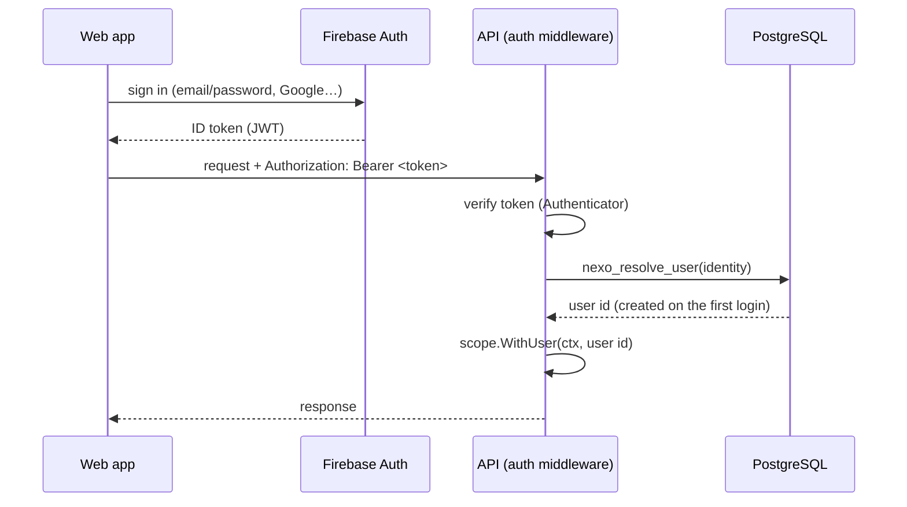

# Authentication and users

**English** · [Español](auth.es.md)

How the API knows who is calling, how users are created and how the platform superadmin works.

## Flow



1. The web app signs in with the Firebase SDK and sends the **ID token** as `Authorization: Bearer <token>`.
2. The auth middleware verifies it through the `Authenticator` interface ([`platform/auth`](../backend/internal/platform/auth/auth.go)); the Firebase implementation lives in [`platform/auth/firebase`](../backend/internal/platform/auth/firebase/firebase.go).
3. The verified identity is mapped to a Nexo user, **created automatically on the first authenticated request**.
4. The user id goes into the request scope: the database layer uses it for Row-Level Security and `created_by`.

Errors are `401` Problem responses with code `MISSING_TOKEN`, `INVALID_TOKEN` or `EMAIL_REQUIRED` (Nexo identifies people by email).

## Which routes are protected

**Every route requires a token unless the contract marks it as public** with `security: []` in [`api/openapi.yaml`](../api/openapi.yaml) (today only `/health`). At startup the router reads the embedded contract to know the public operations. Routes that are not in the contract are protected too: forgetting to declare a route never makes it public.

## Users

Users are global (not tied to a workspace): they will join workspaces through memberships. The `users` table is protected by Row-Level Security:

- A user can **read and edit only their own row** (sharing a workspace will widen reads).
- The API role can only update **profile columns** (`name`, `avatar_url`). RLS filters rows, not columns: without this column restriction a user could make themselves superadmin.
- Users are **never inserted directly**. Two `SECURITY DEFINER` functions (migration `00003`) are the only entry points: narrow, auditable operations that run as the table owner.

### `nexo_resolve_user`: first login and later logins

| Case | Result |
|---|---|
| The identity is already known | Same user; email data refreshed, empty profile fields filled |
| A pre-provisioned row with that email exists (e.g. the superadmin) and the **email is verified** | The row is linked to the identity |
| Otherwise | A new user is created |
| The email belongs to another account | `409 EMAIL_IN_USE` |

Emails are case-insensitive (`citext`). An **unverified** email never takes over an existing account: anyone can register an address they do not own.

## Platform superadmin

The superadmin operates the platform; it is **not** a workspace admin. It is created by the startup bootstrap ([`internal/bootstrap`](../backend/internal/bootstrap/bootstrap.go)) when `BOOTSTRAP_SUPERADMIN_EMAIL` is set:

| Situation | Result |
|---|---|
| A superadmin already exists | Nothing (`exists`) |
| A user with that email exists and has verified it | Promoted (`promoted`) |
| A user with that email exists but has **not** verified it | **Not** promoted, warning in the logs (`unverified`) |
| No user with that email | A pre-provisioned row is created and linked on the first login with a verified email (`created`) |

The bootstrap is idempotent and never demotes or deletes anyone. Being superadmin does not bypass workspace isolation: access to other workspaces will require an explicit, audited support mode.

## Local development

`make up` starts the **Firebase Auth emulator** with the `demo-nexo` project: no real Firebase project or credentials needed.

| | |
|---|---|
| Emulator UI (users, verify emails…) | <http://localhost:4000> |
| Auth emulator (`FIREBASE_AUTH_EMULATOR_HOST`) | `localhost:9099` |

Get a token without the web app (handy with `curl`):

```bash
curl -s -X POST "http://localhost:9099/identitytoolkit.googleapis.com/v1/accounts:signUp?key=fake" \
  -H 'Content-Type: application/json' \
  -d '{"email":"ana@example.com","password":"secret123","returnSecureToken":true}'
```

Use the `idToken` of the response as `Authorization: Bearer <idToken>`. To verify an email, open the Emulator UI.

> The emulator accepts unsigned tokens. The API refuses to start in production if `FIREBASE_AUTH_EMULATOR_HOST` is set.

## Configuration

| Variable | Description |
|---|---|
| `FIREBASE_PROJECT_ID` | Firebase project whose tokens are accepted (`demo-nexo` locally). Required |
| `FIREBASE_AUTH_EMULATOR_HOST` | Emulator address. Local and tests only |
| `BOOTSTRAP_SUPERADMIN_EMAIL` | Optional: makes sure the platform has a superadmin |

## Testing

- **Unit:** the user service with mockery mocks; the router with fake `Authenticator` and repository.
- **Integration:** the Firebase adapter against the emulator ([`fbtest`](../backend/internal/platform/auth/firebase/fbtest/fbtest.go)), and the user repository against PostgreSQL, including RLS and column privileges. The emulator image is built with `make firebase-image` (also run by `make test-integration` and CI).
