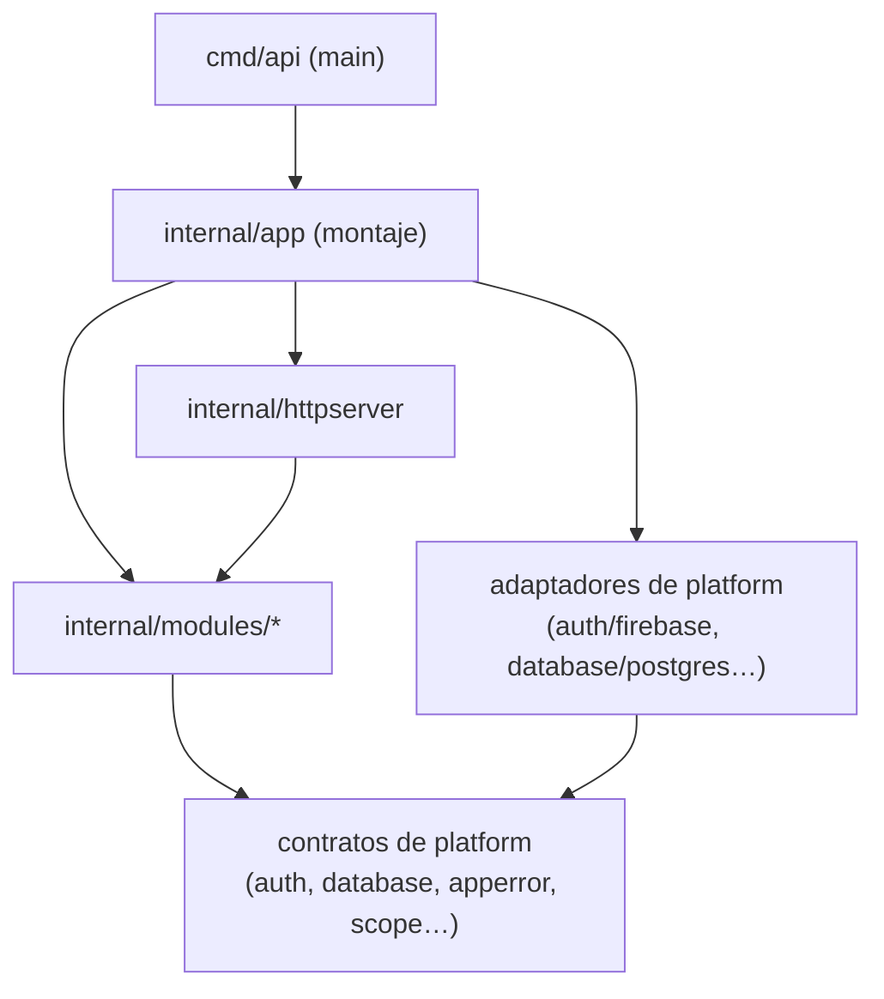

# Arquitectura del backend

[English](README.md) · **Español**

Cómo está construida la API de Nexo: tecnologías, estructura, el recorrido de una petición, las reglas que la mantienen ordenada y cómo trabajar en ella. El *porqué* de cada decisión está en el [registro de decisiones de arquitectura (ADR)](adr/README.es.md).

**Guías relacionadas:** [Acceso a datos](data-access.es.md) · [Autenticación y usuarios](auth.es.md) · [CI](../ci.es.md)

---

## 1. Visión general

El backend es un **monolito modular en Go**: un único binario (`cmd/api`) que sirve una API REST descrita por un **contrato OpenAPI**, guarda los datos en **PostgreSQL** protegidos con **Row-Level Security** y delega la identidad en **Firebase Authentication**.

Principios:

| Principio | Qué significa en la práctica |
|---|---|
| **Primero el contrato** | Todo endpoint empieza en `api/openapi.yaml`; el código del servidor y del cliente se genera a partir de él. |
| **Seguro por defecto** | Las rutas exigen token salvo que el contrato las marque como públicas; la base de datos aísla los espacios de trabajo aunque el código olvide un filtro. |
| **La tecnología, detrás de interfaces** | Firebase, PostgreSQL, el email, el almacenamiento… son adaptadores en `internal/platform`; el código de negocio solo ve interfaces. |
| **Fronteras explícitas** | Los módulos nunca se importan entre sí; las reglas las comprueba un test. |
| **Fallar de forma segura** | Sin usuario ni espacio de trabajo en el alcance, la base de datos no devuelve nada. |
| **Un solo sitio para cada cosa** | Los errores se convierten en HTTP en un único middleware; cada petición se registra una vez; el montaje solo ocurre en `internal/app`. |

## 2. Tecnologías

| Aspecto | Tecnología | Notas |
|---|---|---|
| Lenguaje | Go 1.26 (toolchain fijado en 1.26.10 en `go.mod`) | |
| Router HTTP | [Gin](https://gin-gonic.com/) | Solo dentro de `internal/httpserver` (lo vigila depguard) |
| Contrato de la API | OpenAPI 3.0 + [oapi-codegen](https://github.com/oapi-codegen/oapi-codegen) (servidor estricto) | Código generado en `internal/httpserver/api` |
| Base de datos | PostgreSQL 17 con [pgx v5](https://github.com/jackc/pgx) | `citext`, `unaccent` y `pg_trgm` activadas |
| Migraciones | [goose](https://github.com/pressly/goose), embebidas con `go:embed` | `backend/db/migrations` |
| Autenticación | Firebase Authentication (Admin SDK v4) | Emulador en local |
| Logs | `log/slog` (librería estándar) | JSON para Google Cloud Logging |
| Tests | testify, [mockery](https://vektra.github.io/mockery/) v3, [testcontainers](https://golang.testcontainers.org/) | |
| Lint | golangci-lint v2 (incluye depguard, staticcheck y revive) | `backend/.golangci.yml` |
| Previsto | sqlc (consultas a medida), Pub/Sub (eventos), Firestore (avisos en tiempo real), Resend (email), R2 (archivos) | Ver los ADR 0015 y 0021 |

Herramientas como oapi-codegen, goose y mockery están declaradas como **dependencias de herramientas** de Go en `go.mod` y se ejecutan con `go tool <nombre>`, así que todas las máquinas usan las mismas versiones.

## 3. Estructura del código

```
backend/
├── cmd/api/main.go             Punto de entrada: config, logger, clientes, app, servidor y apagado ordenado
├── db/
│   ├── migrations/             Migraciones SQL (goose), embebidas en el binario
│   └── local/roles.sql         Roles de base de datos solo para desarrollo local y tests
├── internal/
│   ├── app/                    Punto de montaje: el único sitio que conoce las implementaciones concretas
│   ├── bootstrap/              Tareas idempotentes de arranque (superadmin de la plataforma)
│   ├── httpserver/
│   │   ├── router.go           Middlewares y registro de rutas
│   │   ├── public.go           Rutas públicas leídas del contrato embebido
│   │   ├── middleware/         Trace id, logs, errores, recuperación de pánicos y autenticación
│   │   └── api/                Código generado desde api/openapi.yaml (no se edita)
│   ├── modules/                Módulos de negocio (una carpeta por dominio)
│   │   ├── system/             Health check
│   │   └── user/               Usuarios y perfil del usuario autenticado
│   └── platform/               Infraestructura, sin conocimiento del negocio
│       ├── apperror/           Tipo de error de la aplicación
│       ├── auth/               Interfaz Authenticator (+ adaptador firebase/)
│       ├── config/             Configuración por variables de entorno
│       ├── database/           Contratos de datos independientes de la tecnología (+ implementación postgres/)
│       ├── logger/             Configuración de slog y trace id en el contexto
│       └── scope/              Usuario que actúa y espacio de trabajo en el contexto de la petición
├── arch_test.go                Reglas de dependencias entre paquetes
├── .golangci.yml               Reglas de lint (fronteras de depguard para librerías de terceros)
├── .mockery.yml                Mocks generados para los tests unitarios
├── oapi-codegen.yaml           Configuración de la generación del servidor
└── Dockerfile                  Imagen de producción distroless
```

Carpetas previstas: `internal/query/` (consultas de solo lectura que cruzan varios módulos), `internal/events/` (contratos de eventos y despachador), `internal/devseed/` + `cmd/seed/` (datos de desarrollo).

## 4. Capas y reglas de dependencias



Las reglas, comprobadas por [`arch_test.go`](../../backend/arch_test.go) en cada `make test`:

| Regla | Por qué |
|---|---|
| Un módulo nunca importa otro módulo | Los módulos se comunican mediante interfaces pequeñas (puertos) conectadas en `internal/app` |
| Solo `internal/app` y `cmd` importan adaptadores concretos (`platform/<x>/<impl>`) | El código de negocio depende solo de interfaces |
| `platform` nunca importa módulos, HTTP ni el montaje | La infraestructura no sabe nada del negocio |
| `query` (previsto) nunca importa módulos y nunca escribe | Joins de solo lectura para pantallas complejas |
| Los módulos no importan el montaje ni los middlewares HTTP | Sin acoplamiento oculto con el transporte |
| `cmd` no importa módulos, query ni detalles internos de HTTP | `main.go` se mantiene mínimo |

`depguard` (golangci-lint) cubre la parte de terceros: **pgx** solo en `platform/database`, en los ficheros `store_postgres.go` y en el código generado por sqlc; el **SDK de Firebase** solo en sus adaptadores; **Gin** solo en `internal/httpserver` y `cmd`.

Excepción intencionada: los módulos pueden importar `platform/database/postgres`, porque cada módulo es dueño de su repositorio de PostgreSQL (`store_postgres.go`).

## 5. Anatomía de un módulo

Con `internal/modules/user` como ejemplo:

| Fichero | Responsabilidad |
|---|---|
| `user.go` | Entidad (`User`), tipos y la **interfaz `Repository`** que necesita el servicio |
| `service.go` | Lógica de negocio. Solo depende de `Repository` y de contratos de platform |
| `store_postgres.go` | Implementación de `Repository`: `Store[User]` genérico para el CRUD y SQL para el resto |
| `handler.go` | Implementa los métodos del servidor estricto generado (`GetMe`) y convierte las entidades a tipos de la API |
| `mocks/` | Generado por mockery para los tests unitarios |
| `*_test.go` / `*_integration_test.go` | Tests unitarios con mocks / tests de integración contra PostgreSQL |

Los módulos futuros añadirán `ports.go` (interfaces mínimas que necesitan de otros módulos, p. ej. `ProjectReader`) y `events.go` (eventos que publican).

**Necesidades entre módulos:**

- *Validar* (p. ej. «el proyecto existe y no está archivado» al crear una tarea): el consumidor declara un puerto, el módulo dueño lo implementa e `internal/app` los conecta. Las claves foráneas garantizan la integridad igualmente.
- *Completar datos* (p. ej. los nombres de los responsables): una única consulta en bloque (`GetByIDs`), nunca N+1.
- *Pantallas complejas* (tablero, «Mi trabajo», búsqueda): consultas de solo lectura en `internal/query`, que pueden hacer joins entre tablas de varios módulos.
- *Transacciones entre módulos*: `TxManager.WithinTx` lleva una única transacción en el contexto.

## 6. Recorrido de una petición

```mermaid
sequenceDiagram
    participant C as Cliente
    participant G as Gin + middlewares
    participant H as Handler estricto (módulo)
    participant S as Servicio
    participant R as Repositorio / Store
    participant DB as PostgreSQL
    C->>G: petición HTTP
    G->>G: TraceID → Logging → Errors → Recovery → Auth
    G->>H: petición tipada (alcance: usuario, espacio)
    H->>S: llamada
    S->>R: llamada
    R->>DB: BEGIN; set_config(app.user_id, app.workspace_id); consulta
    DB-->>R: filas (filtradas por la RLS)
    R-->>S: entidad / apperror
    S-->>H: resultado / error
    H-->>G: respuesta tipada o error
    G-->>C: JSON, o Problem Details + X-Trace-Id
```

El orden de los middlewares importa (de fuera hacia dentro):

1. **TraceID**: toma `traceparent` / `X-Cloud-Trace-Context` o genera un id; lo guarda en el contexto y lo devuelve en `X-Trace-Id`.
2. **Logging**: al terminar la petición escribe **una** línea con método, ruta, estado, latencia y, si hay error, su tipo, código, ubicación y causa.
3. **Errors**: convierte el último error en **Problem Details (RFC 9457)** (el estado sale del tipo de error; los 5xx nunca muestran detalles internos).
4. **Recovery**: convierte los pánicos en errores `Internal` con la traza (solo en los logs).
5. **Auth**: en las rutas no públicas, token bearer → `Authenticator` → resolución del usuario (se crea en el primer login) → `scope.WithUser`.

Después, el envoltorio generado llama al **handler estricto** del módulo, que recibe una petición tipada y devuelve una respuesta tipada o un error. Un futuro **middleware de espacio de trabajo** validará la membresía en las rutas `/workspaces/{workspaceId}/…` y fijará `scope.WithWorkspace` ([ADR-0017](adr/0017-workspace-in-url-path.es.md)).

## 7. Contrato de la API y generación de código

- `api/openapi.yaml` es la fuente de verdad. Seguridad `bearerAuth` global; las operaciones públicas declaran `security: []`.
- `go generate ./...` ejecuta oapi-codegen (configuración en `backend/oapi-codegen.yaml`) → `internal/httpserver/api/api.gen.go`: modelos, registro en Gin, interfaces del servidor estricto y el contrato embebido.
- El handler de cada módulo implementa una parte de la interfaz estricta; `router.go` incrusta todos los handlers en un único struct `server` (los alias de tipo evitan el choque entre tipos llamados `Handler`).
- `make generate` también regenera los mocks y el cliente del frontend. El CI falla si algo generado no está al día.

**Añadir un endpoint:** editar el contrato → `make generate` → implementar el método en el handler del módulo → servicio/repositorio → tests → el frontend usa el hook generado.

## 8. Acceso a datos (resumen)

Guía completa: **[data-access.es.md](data-access.es.md)**.

- `platform/database` define `Store[T]`, `Entity`, `Model`/`TenantModel`, `Query`, `Filter`, `Page` y `Transactor` (sin tecnología).
- `platform/database/postgres` los implementa: **`Store[T]`** genérico con columnas gestionadas (id UUIDv7, fechas, `created_by`, `workspace_id`, borrado lógico), paginación por cursor y offset, filtros y `Count`; además de `TxManager` y `TranslateError`.
- Las consultas a medida viven en el `store_postgres.go` del módulo y se ejecutan dentro de `WithinTx`.

## 9. Multi-tenancy y seguridad en la base de datos

Defensa en profundidad, toda en PostgreSQL ([ADR-0006](adr/0006-multi-tenancy-rls.es.md), [ADR-0013](adr/0013-user-provisioning.es.md)):

| Capa | Mecanismo |
|---|---|
| Roles | La API se conecta como `nexo_api` (miembro de `nexo_app`), **que no es dueño de las tablas**; las migraciones se ejecutan con el dueño |
| Alcance | `TxManager` fija `app.user_id` / `app.workspace_id` en cada transacción; los leen `nexo_user_id()` / `nexo_workspace_id()` |
| Filas | Cada tabla de espacio de trabajo: `ENABLE` + `FORCE ROW LEVEL SECURITY` y una política sobre `workspace_id = nexo_workspace_id()` |
| Columnas | Permisos por columna donde la RLS no basta (p. ej. los usuarios solo pueden editar `name` y `avatar_url`) |
| Operaciones privilegiadas | Funciones `SECURITY DEFINER` acotadas (`nexo_resolve_user`, `nexo_bootstrap_superadmin`) con `search_path` fijado y `EXECUTE` concedido solo a `nexo_app` |
| Aplicación | El Store también filtra por espacio de trabajo (doble protección) |

Obligatorio para toda entidad de espacio de trabajo: tests de integración que demuestren que otro espacio no puede leer, modificar ni borrar sus filas, incluidas consultas sin ningún `WHERE`.

## 10. Autenticación (resumen)

Guía completa: **[auth.es.md](auth.es.md)**.

ID token de Firebase → `Authenticator.VerifyToken` → `nexo_resolve_user` (alta automática; las cuentas preparadas solo se vinculan con el email verificado) → id del usuario en el alcance. `GET /me` devuelve el perfil. El superadmin de la plataforma lo crea `internal/bootstrap` a partir de `BOOTSTRAP_SUPERADMIN_EMAIL`.

## 11. Errores

`platform/apperror` ([ADR-0009](adr/0009-errors-problem-details.es.md)):

| Tipo | HTTP | Códigos habituales |
|---|---|---|
| `VALIDATION` | 400 | `INVALID_REQUEST`, `INVALID_CURSOR`, `INVALID_EMAIL`, `REFERENCE_NOT_FOUND` |
| `UNAUTHENTICATED` | 401 | `MISSING_TOKEN`, `INVALID_TOKEN`, `EMAIL_REQUIRED` |
| `FORBIDDEN` | 403 | `FORBIDDEN` (incluye rechazos de la RLS) |
| `NOT_FOUND` | 404 | `<RECURSO>_NOT_FOUND`, `ROUTE_NOT_FOUND` |
| `CONFLICT` | 409 | `ALREADY_EXISTS`, `EMAIL_IN_USE` |
| `UNAVAILABLE` | 503 | `SERVICE_UNAVAILABLE` |
| `INTERNAL` | 500 | `INTERNAL_ERROR` |

Reglas: crear los errores con los constructores con nombre; envolver las causas; devolverlos (los módulos nunca escriben respuestas HTTP); los códigos forman parte del contrato público y necesitan su traducción en el frontend.

Ejemplo de respuesta:

```json
{
  "type": "about:blank",
  "title": "Not Found",
  "status": 404,
  "code": "TASK_NOT_FOUND",
  "detail": "task 0192f7a4-… not found",
  "traceId": "4bf92f3577b34da6a3ce929d0e0e4736"
}
```

## 12. Logs y observabilidad

- `slog` en JSON con los campos de Cloud Logging (`severity`, `message`) fuera de desarrollo; texto en desarrollo.
- `trace_id` se añade automáticamente a todo log escrito con el contexto de la petición.
- Una línea por petición (el health check en `DEBUG`). 4xx → `WARNING` sin detalles internos; 5xx → `ERROR` con `error_location` y `error_cause`.
- Previsto: trazas y métricas con OpenTelemetry.

## 13. Configuración

Se lee de variables de entorno; en desarrollo local se carga un fichero `.env` ([`.env.example`](../../.env.example)).

| Variable | Valor por defecto | Descripción |
|---|---|---|
| `APP_ENV` | `development` | `development`, `test` o `production` |
| `PORT` | `8080` | Puerto HTTP |
| `LOG_LEVEL` | `info` | `debug`, `info`, `warn`, `error` |
| `DATABASE_URL` | — (obligatoria) | Conexión con el rol de la API (`nexo_api`) |
| `FIREBASE_PROJECT_ID` | — (obligatoria) | `demo-nexo` en local |
| `FIREBASE_AUTH_EMULATOR_HOST` | — | Solo en local y en tests; se rechaza en producción |
| `BOOTSTRAP_SUPERADMIN_EMAIL` | — | Alta opcional del superadmin |

## 14. Arranque y apagado

`cmd/api/main.go` solo hace esto: cargar la configuración → crear el logger → conectar con PostgreSQL → crear el autenticador de Firebase → `app.New` (montaje) → `app.Bootstrap` (tareas idempotentes) → servir → ante `SIGINT`/`SIGTERM`, apagado ordenado (15 s). La versión se inyecta al compilar (`-ldflags "-X main.version=…"`).

## 15. Migraciones de la base de datos

- `make db-migrate` / `db-rollback` / `db-status` / `db-new name=…` / `db-reset`, ejecutadas con el **dueño** de las tablas (`DB_URL` en el Makefile).
- Migraciones actuales: `00001` extensiones, `00002` rol `nexo_app` + funciones auxiliares de la RLS, `00003` usuarios + funciones de alta.
- Las tablas nuevas de espacio de trabajo siguen la plantilla de [data-access.es.md](data-access.es.md#añadir-una-tabla-de-espacio-de-trabajo) (RLS, política, índices).

## 16. Tests

| Nivel | Comando | Qué |
|---|---|---|
| Unitarios | `make test` | Servicios con mocks de mockery, router con adaptadores falsos, `arch_test.go` |
| Integración | `make test-integration` | PostgreSQL y el emulador de Firebase Auth con testcontainers: Store, RLS, permisos por columna, alta de usuarios y adaptador de Firebase |

Detalles y convenciones en el [ADR-0018](adr/0018-testing-strategy.es.md). Utilidades: `pgtest` (base de datos con conexiones del rol de la API y del dueño) y `fbtest` (emulador, registro, inicio de sesión y verificación de email).

## 17. Desarrollo local

```bash
make up          # PostgreSQL (5433) + emulador de Firebase Auth (9099, interfaz en 4000) + roles de BD
make db-migrate  # aplica las migraciones
make dev-api     # API en http://localhost:8080
make test        # tests unitarios
make test-integration
make generate    # tras cambiar el contrato o una interfaz con mocks
make lint
```

## 18. Próximos pasos de la arquitectura

| Elemento | Estado | ADR |
|---|---|---|
| Espacios de trabajo, membresías y middleware de espacio | Siguiente (hito M0) | [0017](adr/0017-workspace-in-url-path.es.md) |
| Comandos, eventos y outbox transaccional | Previsto | [0015](adr/0015-commands-and-outbox.es.md) |
| sqlc para las consultas a medida | Previsto | [0005](adr/0005-data-access-store.es.md) |
| Modelos de lectura en `internal/query` | Previsto | [0002](adr/0002-modular-monolith.es.md) |
| Avisos en tiempo real con Firestore | Previsto | [0021](adr/0021-realtime-signals.es.md) |
| Campos personalizados en JSONB | Fase 2 | [0016](adr/0016-custom-fields-jsonb.es.md) |
| Email (Mailer + Mailpit) y archivos (FileStorage + MinIO/R2) | Con las invitaciones / los adjuntos | — |
| Despliegue en Cloud Run (Workload Identity Federation) | Más adelante | — |
