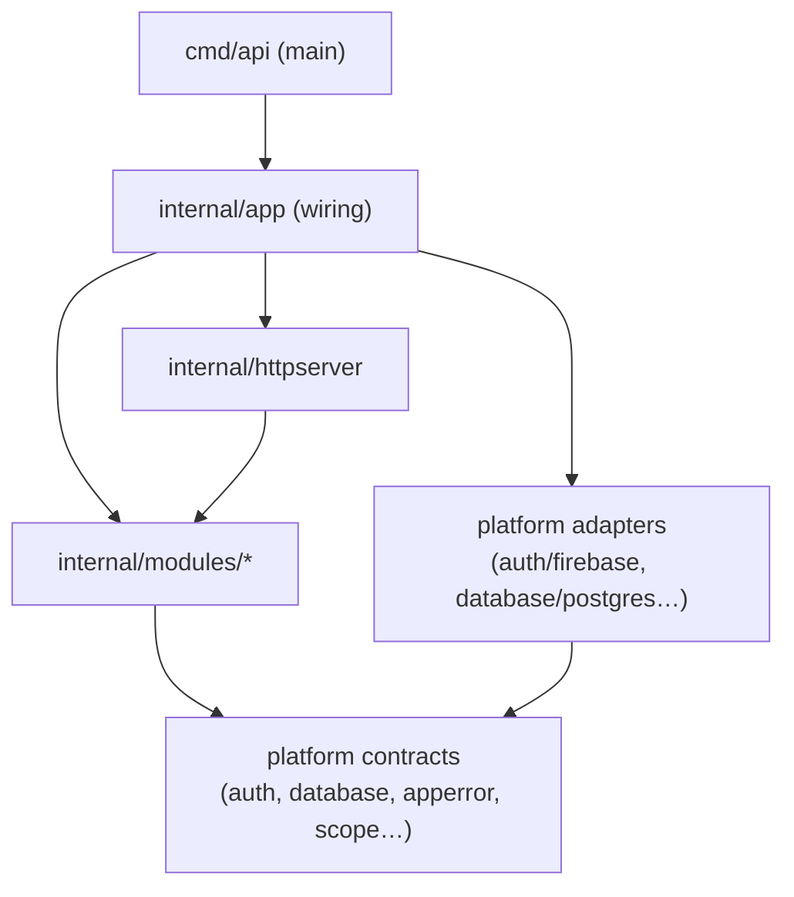

# Backend architecture

**English** · [Español](README.es.md)

How the Nexo API is built: technologies, structure, how a request flows through it, the rules that keep it maintainable, and how to work on it. The *why* behind each choice is in the [Architecture Decision Records](adr/README.md).

**Related guides:** [Data access](data-access.md) · [Authentication and users](auth.md) · [CI](../ci.md)

---

## 1. Overview

The backend is a **modular monolith in Go**: a single binary (`cmd/api`) that serves a REST API described by an **OpenAPI contract**, stores data in **PostgreSQL** protected by **Row-Level Security**, and delegates identity to **Firebase Authentication**.

Guiding principles:

| Principle | What it means in practice |
|---|---|
| **Contract first** | Every endpoint starts in `api/openapi.yaml`; server and client code are generated from it. |
| **Secure by default** | Routes require a token unless the contract marks them public; the database isolates workspaces even if code forgets a filter. |
| **Technology behind interfaces** | Firebase, PostgreSQL, email, storage… are adapters in `internal/platform`; business code sees interfaces. |
| **Explicit boundaries** | Modules never import each other; the rules are checked by a test. |
| **Fail closed** | Without a user and workspace scope, the database returns nothing. |
| **One place for each concern** | Errors become HTTP in one middleware; each request is logged once; wiring happens only in `internal/app`. |

## 2. Technology stack

| Concern | Technology | Notes |
|---|---|---|
| Language | Go 1.26 (toolchain pinned to 1.26.10 in `go.mod`) | |
| HTTP router | [Gin](https://gin-gonic.com/) | Only inside `internal/httpserver` (enforced by depguard) |
| API contract | OpenAPI 3.0 + [oapi-codegen](https://github.com/oapi-codegen/oapi-codegen) (strict server) | Generated code in `internal/httpserver/api` |
| Database | PostgreSQL 17 via [pgx v5](https://github.com/jackc/pgx) | `citext`, `unaccent`, `pg_trgm` enabled |
| Migrations | [goose](https://github.com/pressly/goose), embedded with `go:embed` | `backend/db/migrations` |
| Authentication | Firebase Authentication (Admin SDK v4) | Emulator locally |
| Logging | `log/slog` (standard library) | JSON for Google Cloud Logging |
| Tests | testify, [mockery](https://vektra.github.io/mockery/) v3, [testcontainers](https://golang.testcontainers.org/) | |
| Lint | golangci-lint v2 (incl. depguard, staticcheck, revive) | `backend/.golangci.yml` |
| Planned | sqlc (custom queries), Pub/Sub (events), Firestore (real-time signals), Resend (email), R2 (files) | See ADRs 0015 and 0021 |

Tools such as oapi-codegen, goose and mockery are declared as Go **tool dependencies** in `go.mod` and run with `go tool <name>`, so every machine uses the same versions.

## 3. Repository layout

```
backend/
├── cmd/api/main.go             Entry point: config, logger, clients, app, server, graceful shutdown
├── db/
│   ├── migrations/             SQL migrations (goose), embedded in the binary
│   └── local/roles.sql         Database roles for local development and tests only
├── internal/
│   ├── app/                    Composition root: the only place that knows concrete implementations
│   ├── bootstrap/              Idempotent startup tasks (platform superadmin)
│   ├── httpserver/
│   │   ├── router.go           Middlewares and route registration
│   │   ├── public.go           Public routes read from the embedded contract
│   │   ├── middleware/         Trace id, logging, errors, recovery, auth
│   │   └── api/                Code generated from api/openapi.yaml (do not edit)
│   ├── modules/                Business modules (one folder per domain)
│   │   ├── system/             Health check
│   │   ├── user/               Users and the authenticated profile
│   │   └── workspace/          Workspaces, memberships and roles
│   └── platform/               Infrastructure, no business knowledge
│       ├── apperror/           Application error type
│       ├── auth/               Authenticator interface (+ firebase/ adapter)
│       ├── config/             Environment configuration
│       ├── database/           Technology-agnostic data contracts (+ postgres/ implementation)
│       ├── logger/             slog setup and trace id in context
│       └── scope/              Acting user and workspace in the request context
├── arch_test.go                Dependency rules between packages
├── .golangci.yml               Lint rules (depguard boundaries for third-party libraries)
├── .mockery.yml                Mocks generated for unit tests
├── oapi-codegen.yaml           Server code generation settings
└── Dockerfile                  Distroless production image
```

Planned folders: `internal/query/` (read-only queries that join several modules), `internal/events/` (event contracts and dispatcher), `internal/devseed/` + `cmd/seed/` (development data).

## 4. Layers and dependency rules



The rules, enforced by [`arch_test.go`](../../backend/arch_test.go) on every `make test`:

| Rule | Why |
|---|---|
| A module never imports another module | Modules talk through small interfaces (ports) wired in `internal/app` |
| Only `internal/app` and `cmd` import concrete adapters (`platform/<x>/<impl>`) | Business code depends on interfaces only |
| `platform` never imports modules, HTTP or wiring | Infrastructure knows nothing about the business |
| `query` (planned) never imports modules and never writes | Read-only joins for complex screens |
| Modules do not import wiring or HTTP middlewares | No hidden coupling to the transport |
| `cmd` does not import modules, query or HTTP internals | `main.go` stays thin |

`depguard` (golangci-lint) adds the third-party side: **pgx** only in `platform/database`, `store_postgres.go` files and generated sqlc code; the **Firebase SDK** only in its adapters; **Gin** only in `internal/httpserver` and `cmd`.

Exception by design: modules may import `platform/database/postgres`, because each module owns its PostgreSQL repository (`store_postgres.go`).

## 5. Anatomy of a module

Using `internal/modules/user` as the example:

| File | Responsibility |
|---|---|
| `user.go` | Entity (`User`), types and the **`Repository` interface** the service needs |
| `service.go` | Business logic. Depends on `Repository` and platform contracts only |
| `store_postgres.go` | `Repository` implementation: generic `Store[User]` for CRUD, SQL for the rest |
| `handler.go` | Implements the generated strict-server methods (`GetMe`) and maps entities to API types |
| `mocks/` | Generated by mockery for unit tests |
| `*_test.go` / `*_integration_test.go` | Unit tests with mocks / integration tests against PostgreSQL |

Future modules will add `ports.go` (minimal interfaces they need from other modules, e.g. `ProjectReader`) and `events.go` (events they publish).

**Cross-module needs:**

- *Validation* (e.g. "the project exists and is not archived" when creating a task): the consumer declares a port; the owner module implements it; `internal/app` connects them. Foreign keys guarantee integrity anyway.
- *Enrichment* (e.g. assignee names): one batch query (`GetByIDs`), never N+1.
- *Complex screens* (board, "My work", search): read-only queries in `internal/query`, allowed to join tables of several modules.
- *Transactions spanning modules*: `TxManager.WithinTx` carries one transaction in the context.

## 6. Request lifecycle

```mermaid
sequenceDiagram
    participant C as Client
    participant G as Gin + middlewares
    participant H as Strict handler (module)
    participant S as Service
    participant R as Repository / Store
    participant DB as PostgreSQL
    C->>G: HTTP request
    G->>G: TraceID → Logging → Errors → Recovery → Auth → Workspace
    G->>H: typed request (scope: user, workspace)
    H->>S: call
    S->>R: call
    R->>DB: BEGIN; set_config(app.user_id, app.workspace_id); query
    DB-->>R: rows (filtered by RLS)
    R-->>S: entity / apperror
    S-->>H: result / error
    H-->>G: typed response or error
    G-->>C: JSON, or Problem Details + X-Trace-Id
```

Middleware order matters (outer to inner):

1. **TraceID** — takes `traceparent` / `X-Cloud-Trace-Context` or generates an id; stores it in the context; returns `X-Trace-Id`.
2. **Logging** — after the request, writes **one** line with method, route, status, latency and, for errors, kind, code, location and cause.
3. **Errors** — converts the last error into **RFC 9457 Problem Details** (status from the error kind; 5xx never show internals).
4. **Recovery** — turns panics into `Internal` errors with the stack trace (in the logs only).
5. **Auth** — on non-public routes: bearer token → `Authenticator` → user resolved (created on first login) → `scope.WithUser`.
6. **Workspace** — on routes with `{workspaceId}`: checks the membership (non-members get **404**, so existence is not revealed) → `scope.WithWorkspace` + `scope.WithWorkspaceRole`. From there the workspace reaches Row-Level Security.

Then the generated wrapper calls the module's **strict handler**, which receives a typed request and returns a typed response or an error. Workspace handlers read the workspace and role from the scope, never from the request ([ADR-0017](adr/0017-workspace-in-url-path.md)).

## 7. API contract and code generation

- `api/openapi.yaml` is the source of truth. Global `bearerAuth` security; public operations declare `security: []`.
- `go generate ./...` runs oapi-codegen (config `backend/oapi-codegen.yaml`) → `internal/httpserver/api/api.gen.go`: models, Gin registration, strict-server interfaces and the embedded spec.
- Each module's handler implements part of the strict interface; `router.go` embeds all handlers in one `server` struct (type aliases avoid name clashes between `Handler` types).
- `make generate` also regenerates mocks and the frontend client. CI fails if anything generated is stale.

**Adding an endpoint:** edit the contract → `make generate` → implement the method in the module's handler → service/repository → tests → frontend uses the generated hook.

## 8. Data access (summary)

Full guide: **[data-access.md](data-access.md)**.

- `platform/database` defines `Store[T]`, `Entity`, `Model`/`TenantModel`, `Query`, `Filter`, `Page`, `Transactor` (no technology).
- `platform/database/postgres` implements them: generic **`Store[T]`** with managed columns (UUIDv7 id, timestamps, `created_by`, `workspace_id`, soft delete), cursor/offset pagination, filters and `Count`; plus `TxManager` and `TranslateError`.
- Custom queries live in the module's `store_postgres.go` and run inside `WithinTx`.

## 9. Multi-tenancy and database security

Defense in depth, all in PostgreSQL ([ADR-0006](adr/0006-multi-tenancy-rls.md), [ADR-0013](adr/0013-user-provisioning.md)):

| Layer | Mechanism |
|---|---|
| Roles | API connects as `nexo_api` (member of `nexo_app`), **not the table owner**; migrations run as the owner |
| Scope | `TxManager` sets `app.user_id` / `app.workspace_id` per transaction; read by `nexo_user_id()` / `nexo_workspace_id()` |
| Rows | Every tenant table: `ENABLE ROW LEVEL SECURITY` (not `FORCE`, [ADR-0022](adr/0022-rls-without-force.md)) and a policy on `workspace_id = nexo_workspace_id()` |
| Columns | Column privileges where RLS is not enough (e.g. users can edit only `name`, `avatar_url`) |
| Privileged operations | Narrow `SECURITY DEFINER` functions (`nexo_resolve_user`, `nexo_bootstrap_superadmin`, `nexo_create_workspace`) with `search_path` pinned and `EXECUTE` granted only to `nexo_app` |
| Invariants | Triggers for rules that must hold whatever the caller (a workspace always keeps one admin) |
| Application | The Store also filters by workspace (belt and braces) |

Mandatory for every tenant entity: integration tests proving another workspace cannot read, update or delete its rows — including queries with no `WHERE`.

## 10. Workspaces and roles

Module `internal/modules/workspace` ([ADR-0023](adr/0023-workspaces-and-roles.md)):

| Action | Who | Endpoint |
|---|---|---|
| Create a workspace (creator becomes admin) | Any user | `POST /workspaces` |
| List my workspaces, with my role | Any user | `GET /workspaces` |
| See a workspace / its members | Members | `GET /workspaces/{id}`, `GET /workspaces/{id}/members` |
| Rename | Admins | `PATCH /workspaces/{id}` |
| Change a member's role | Admins | `PATCH /workspaces/{id}/members/{userId}` |
| Remove a member / leave | Admins / oneself | `DELETE /workspaces/{id}/members/{userId}` |

Every rule is checked twice: by the service (clear error codes) and by PostgreSQL (policies, column privileges and a trigger that keeps at least one admin). Integration tests prove the database enforces them on its own.

## 11. Authentication (summary)

Full guide: **[auth.md](auth.md)**.

Firebase ID token → `Authenticator.VerifyToken` → `nexo_resolve_user` (just-in-time creation, linking pre-provisioned accounts only with a verified email) → user id in scope. `GET /me` returns the profile. The platform superadmin is provisioned by `internal/bootstrap` from `BOOTSTRAP_SUPERADMIN_EMAIL`.

## 12. Errors

`platform/apperror` ([ADR-0009](adr/0009-errors-problem-details.md)):

| Kind | HTTP | Typical codes |
|---|---|---|
| `VALIDATION` | 400 | `INVALID_REQUEST`, `INVALID_CURSOR`, `INVALID_EMAIL`, `REFERENCE_NOT_FOUND`, `INVALID_WORKSPACE_ID`, `INVALID_WORKSPACE_NAME`, `INVALID_ROLE` |
| `UNAUTHENTICATED` | 401 | `MISSING_TOKEN`, `INVALID_TOKEN`, `EMAIL_REQUIRED` |
| `FORBIDDEN` | 403 | `FORBIDDEN` (incl. RLS denials), `WORKSPACE_ADMIN_REQUIRED` |
| `NOT_FOUND` | 404 | `<RESOURCE>_NOT_FOUND`, `ROUTE_NOT_FOUND` |
| `CONFLICT` | 409 | `ALREADY_EXISTS`, `EMAIL_IN_USE`, `LAST_ADMIN` |
| `UNAVAILABLE` | 503 | `SERVICE_UNAVAILABLE` |
| `INTERNAL` | 500 | `INTERNAL_ERROR` |

Rules: create errors with the named constructors; wrap causes; return them (never write HTTP responses in modules); codes are part of the public contract and need a frontend translation.

Response example:

```json
{
  "type": "about:blank",
  "title": "Not Found",
  "status": 404,
  "code": "TASK_NOT_FOUND",
  "detail": "task 0192f7a4-… not found",
  "traceId": "4bf92f3577b34da6a3ce929d0e0e4736"
}
```

## 13. Logging and observability

- `slog` JSON with Cloud Logging keys (`severity`, `message`) outside development; text in development.
- `trace_id` is added automatically to every record logged with the request context.
- One line per request (health checks at `DEBUG`). 4xx → `WARNING` without internals; 5xx → `ERROR` with `error_location` and `error_cause`.
- Planned: OpenTelemetry tracing and metrics.

## 14. Configuration

Read from environment variables; a `.env` file is loaded in local development ([`.env.example`](../../.env.example)).

| Variable | Default | Description |
|---|---|---|
| `APP_ENV` | `development` | `development`, `test` or `production` |
| `PORT` | `8080` | HTTP port |
| `LOG_LEVEL` | `info` | `debug`, `info`, `warn`, `error` |
| `DATABASE_URL` | — (required) | Connection as the API role (`nexo_api`) |
| `FIREBASE_PROJECT_ID` | — (required) | `demo-nexo` locally |
| `FIREBASE_AUTH_EMULATOR_HOST` | — | Local and tests only; refused in production |
| `BOOTSTRAP_SUPERADMIN_EMAIL` | — | Optional superadmin provisioning |

## 15. Startup and shutdown

`cmd/api/main.go` does only this: load config → create logger → connect to PostgreSQL → create the Firebase authenticator → `app.New` (wiring) → `app.Bootstrap` (idempotent tasks) → serve → on `SIGINT`/`SIGTERM`, graceful shutdown (15 s). The version is injected at build time (`-ldflags "-X main.version=…"`).

## 16. Database migrations

- `make db-migrate` / `db-rollback` / `db-status` / `db-new name=…` / `db-reset`, run as the table **owner** (`DB_URL` in the Makefile).
- Current migrations: `00001` extensions, `00002` `nexo_app` role + RLS helper functions, `00003` users + provisioning functions, `00004` RLS without `FORCE`, `00005` workspaces and memberships.
- New tenant tables follow the template in [data-access.md](data-access.md#adding-a-tenant-table) (RLS, policy, indexes).

## 17. Testing

| Level | Command | What |
|---|---|---|
| Unit | `make test` | Services with mockery mocks, router with fake adapters, `arch_test.go` |
| Integration | `make test-integration` | PostgreSQL and the Firebase Auth emulator via testcontainers: Store, RLS, column privileges, user provisioning, Firebase adapter |

Details and conventions in [ADR-0018](adr/0018-testing-strategy.md). Helpers: `pgtest` (database with API-role and owner pools; the owner is **not** a superuser, like in a managed database) and `fbtest` (emulator, sign-up/sign-in, verify email).

## 18. Local development

```bash
make up          # PostgreSQL (5433) + Firebase Auth emulator (9099, UI on 4000) + DB roles
make db-migrate  # apply migrations
make dev-api     # API on http://localhost:8080
make test        # unit tests
make test-integration
make generate    # after changing the contract or an interface with mocks
make lint
```

## 19. What is next for the architecture

| Item | Status | ADR |
|---|---|---|
| Workspaces, memberships and the workspace middleware | ✅ Done | [0017](adr/0017-workspace-in-url-path.md), [0023](adr/0023-workspaces-and-roles.md) |
| Invitations (email and link), Mailer + Mailpit | Next (milestone M0) | — |
| Commands, events and transactional outbox | Planned | [0015](adr/0015-commands-and-outbox.md) |
| sqlc for custom queries | Planned | [0005](adr/0005-data-access-store.md) |
| `internal/query` read models | Planned | [0002](adr/0002-modular-monolith.md) |
| Real-time signals via Firestore | Planned | [0021](adr/0021-realtime-signals.md) |
| Custom fields in JSONB | Phase 2 | [0016](adr/0016-custom-fields-jsonb.md) |
| Email (Mailer + Mailpit), files (FileStorage + MinIO/R2) | With invitations / attachments | — |
| Deployment to Cloud Run (Workload Identity Federation) | Later | — |
