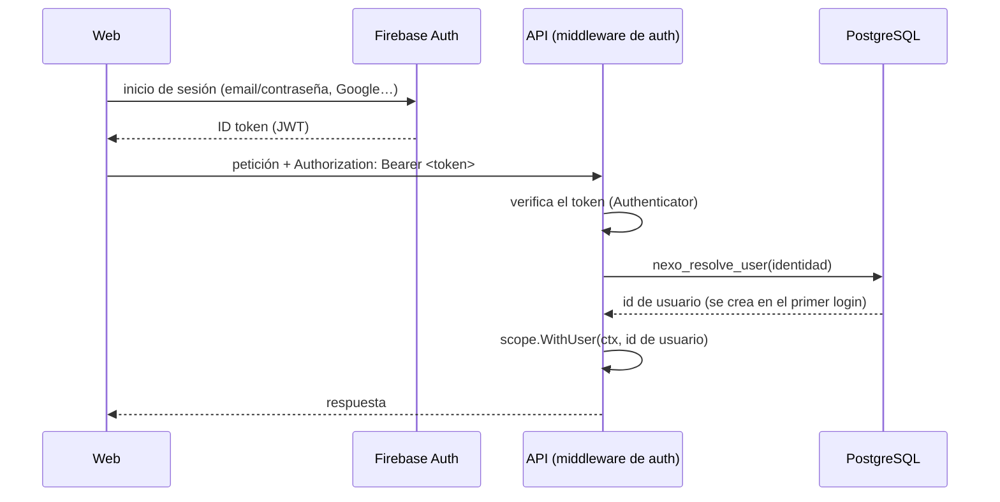

# Autenticación y usuarios

[English](auth.md) · **Español**

Cómo sabe la API quién hace cada petición, cómo se crean los usuarios y cómo funciona el superadmin de la plataforma.

## Flujo



1. La web inicia sesión con el SDK de Firebase y envía el **ID token** como `Authorization: Bearer <token>`.
2. El middleware de autenticación lo verifica a través de la interfaz `Authenticator` ([`platform/auth`](../../backend/internal/platform/auth/auth.go)); la implementación de Firebase está en [`platform/auth/firebase`](../../backend/internal/platform/auth/firebase/firebase.go).
3. La identidad verificada se asocia a un usuario de Nexo, que **se crea automáticamente en la primera petición autenticada**.
4. El id del usuario entra en el alcance de la petición: la capa de base de datos lo usa para la Row-Level Security y para `created_by`.

Los errores son respuestas `401` en formato Problem con el código `MISSING_TOKEN`, `INVALID_TOKEN` o `EMAIL_REQUIRED` (Nexo identifica a las personas por su email).

## Qué rutas están protegidas

**Todas las rutas exigen token salvo que el contrato las marque como públicas** con `security: []` en [`api/openapi.yaml`](../../api/openapi.yaml) (hoy solo `/health`). Al arrancar, el router lee el contrato embebido para saber qué operaciones son públicas. Las rutas que no están en el contrato también quedan protegidas: olvidarse de declarar una ruta nunca la hace pública.

## Usuarios

Los usuarios son globales (no pertenecen a un espacio de trabajo): se unirán a los espacios mediante membresías. La tabla `users` está protegida con Row-Level Security:

- Cada usuario **solo puede leer y editar su propia fila** (compartir un espacio de trabajo ampliará las lecturas).
- El rol de la API solo puede actualizar las **columnas del perfil** (`name`, `avatar_url`). La RLS filtra filas, no columnas: sin esta restricción por columnas, un usuario podría hacerse superadmin a sí mismo.
- Los usuarios **nunca se insertan directamente**. Dos funciones `SECURITY DEFINER` (migración `00003`) son el único punto de entrada: operaciones acotadas y auditables que se ejecutan como dueño de la tabla.

### `nexo_resolve_user`: primer login y siguientes

| Caso | Resultado |
|---|---|
| La identidad ya es conocida | El mismo usuario; se actualizan los datos del email y se rellenan los campos de perfil vacíos |
| Existe una fila preparada con ese email (p. ej. el superadmin) y el **email está verificado** | La fila se vincula a la identidad |
| En otro caso | Se crea un usuario nuevo |
| El email pertenece a otra cuenta | `409 EMAIL_IN_USE` |

Los emails no distinguen mayúsculas (`citext`). Un email **sin verificar** nunca se apropia de una cuenta existente: cualquiera puede registrar una dirección que no es suya.

## Superadmin de la plataforma

El superadmin opera la plataforma; **no** es el administrador de un espacio de trabajo. Lo crea el bootstrap de arranque ([`internal/bootstrap`](../../backend/internal/bootstrap/bootstrap.go)) cuando está definida `BOOTSTRAP_SUPERADMIN_EMAIL`:

| Situación | Resultado |
|---|---|
| Ya existe un superadmin | Nada (`exists`) |
| Existe un usuario con ese email y lo ha verificado | Se le hace superadmin (`promoted`) |
| Existe un usuario con ese email pero **no** lo ha verificado | **No** se le hace superadmin; aviso en los logs (`unverified`) |
| No hay ningún usuario con ese email | Se crea una fila preparada, que se vincula en el primer login con el email verificado (`created`) |

El bootstrap es idempotente y nunca degrada ni borra a nadie. Ser superadmin no se salta el aislamiento entre espacios: entrar en otros espacios requerirá un modo soporte explícito y auditado.

## Desarrollo local

`make up` levanta el **emulador de Firebase Auth** con el proyecto `demo-nexo`: no hace falta un proyecto real de Firebase ni credenciales.

| | |
|---|---|
| Interfaz del emulador (usuarios, verificar emails…) | <http://localhost:4000> |
| Emulador de Auth (`FIREBASE_AUTH_EMULATOR_HOST`) | `localhost:9099` |

Para obtener un token sin la web (útil con `curl`):

```bash
curl -s -X POST "http://localhost:9099/identitytoolkit.googleapis.com/v1/accounts:signUp?key=fake" \
  -H 'Content-Type: application/json' \
  -d '{"email":"ana@example.com","password":"secret123","returnSecureToken":true}'
```

Usa el `idToken` de la respuesta como `Authorization: Bearer <idToken>`. Para verificar un email, abre la interfaz del emulador.

> El emulador acepta tokens sin firmar. La API se niega a arrancar en producción si `FIREBASE_AUTH_EMULATOR_HOST` está definida.

## Configuración

| Variable | Descripción |
|---|---|
| `FIREBASE_PROJECT_ID` | Proyecto de Firebase cuyos tokens se aceptan (`demo-nexo` en local). Obligatoria |
| `FIREBASE_AUTH_EMULATOR_HOST` | Dirección del emulador. Solo en local y en tests |
| `BOOTSTRAP_SUPERADMIN_EMAIL` | Opcional: garantiza que la plataforma tenga un superadmin |

## Tests

- **Unitarios:** el servicio de usuarios con mocks de mockery; el router con un `Authenticator` y un repositorio falsos.
- **Integración:** el adaptador de Firebase contra el emulador ([`fbtest`](../../backend/internal/platform/auth/firebase/fbtest/fbtest.go)) y el repositorio de usuarios contra PostgreSQL, incluidas la RLS y los permisos por columna. La imagen del emulador se construye con `make firebase-image` (también lo hacen `make test-integration` y el CI).
