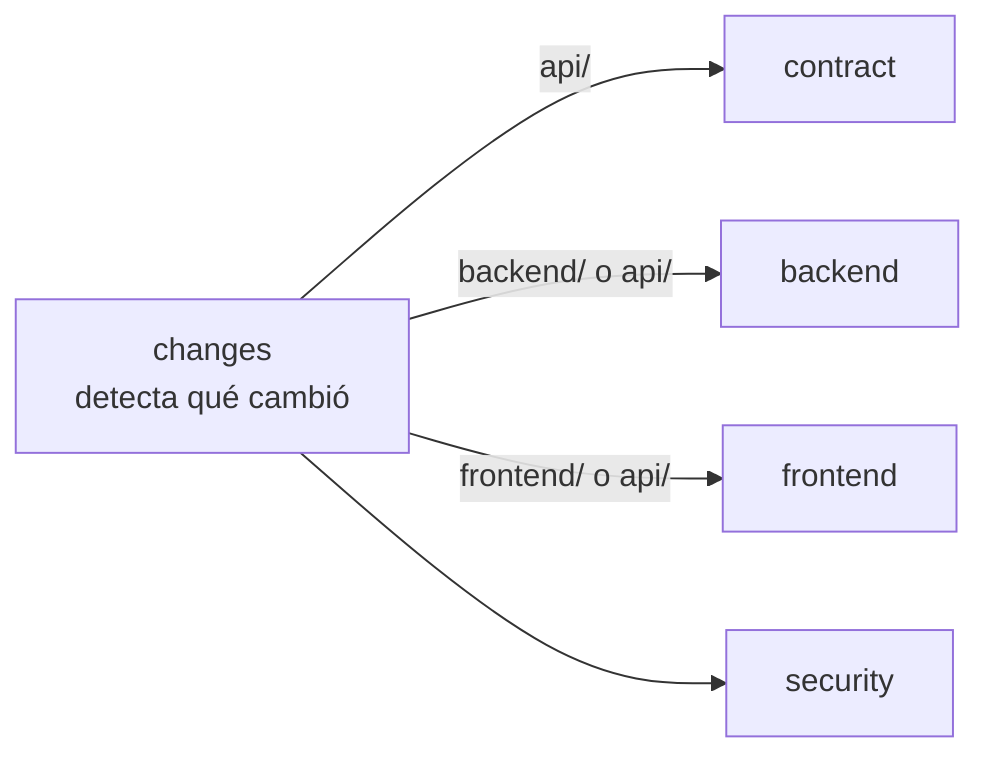

# Integración continua (CI)

[English](ci.md) · **Español**

Este documento explica cómo funciona el CI de Nexo en GitHub Actions: cuándo se ejecuta, qué comprueba cada job, cómo reproducir un fallo en local y cómo encaja con las reglas de la rama `main`.

Los workflows están en [`.github/workflows/`](../.github/workflows/):

| Fichero | Para qué sirve |
|---|---|
| [`ci.yml`](../.github/workflows/ci.yml) | Pipeline principal: contrato, backend, frontend y seguridad |
| [`codeql.yml`](../.github/workflows/codeql.yml) | Análisis estático de seguridad del código (GitHub CodeQL) |
| [`dependabot.yml`](../.github/dependabot.yml) | Pull requests automáticos para actualizar dependencias |

## ¿Cuándo se ejecuta?

```yaml
on:
  pull_request:
    branches: [main]
  push:
    branches: [main]
```

| Situación | ¿Se ejecuta? |
|---|---|
| Subes commits a una rama sin pull request abierto | ❌ No |
| Abres un pull request hacia `main` | ✅ Sí |
| Subes más commits a una rama con un pull request abierto hacia `main` | ✅ Sí, de nuevo, sobre el estado nuevo |
| Se hace merge de un pull request en `main` | ✅ Sí, una vez, sobre `main` con el merge aplicado |

Dos detalles:

- **En un pull request, GitHub prueba el resultado de combinar tu rama con `main`**, no tu rama sola. Los problemas que solo aparecen al juntar ambas se detectan antes del merge.
- **La ejecución en `main` tras cada merge** detecta el caso en que dos pull requests pasan por separado pero chocan entre sí. Además, será el punto de partida del despliegue continuo (CD).

### Cancelación de ejecuciones obsoletas

```yaml
concurrency:
  group: ci-${{ github.ref }}
  cancel-in-progress: true
```

Si subes un commit nuevo mientras la ejecución anterior de la misma rama sigue en marcha, la anterior se cancela. Solo importa el estado más reciente, y así se ahorran minutos.

### Permisos

El workflow se ejecuta por defecto con `contents: read` (puede leer el código, pero no modificar el repositorio). Solo el job que detecta cambios tiene además `pull-requests: read`. Es el principio de mínimo privilegio: si una dependencia o una acción estuviera comprometida, no podría escribir en el repositorio.

## Vista general



El primer job detecta **qué partes del monorepo han cambiado** y el resto solo se ejecuta si le afecta. Un cambio solo en el frontend no ejecuta los tests de Go, y al revés. Un cambio en `api/openapi.yaml` afecta a todo, porque de él se generan tanto el servidor como el cliente. Los cambios en el propio `ci.yml` lanzan los jobs de backend y frontend, para que al editar el pipeline también se pruebe.

Los jobs que no aplican aparecen como **skipped** (omitidos) en GitHub, lo que cuenta como éxito para los checks obligatorios.

## Jobs

### 1. `changes` — Detectar cambios

Usa [`dorny/paths-filter`](https://github.com/dorny/paths-filter) para comparar los ficheros modificados con estos filtros:

| Salida | Rutas |
|---|---|
| `api` | `api/**`, `redocly.yaml` |
| `backend` | `backend/**`, `api/**`, `docker/**`, `.github/workflows/ci.yml` |
| `frontend` | `frontend/**`, `api/**`, `.github/workflows/ci.yml` |

### 2. `contract` — Contrato de la API

Se ejecuta si cambia `api/`.

| Paso | Qué comprueba | Por qué |
|---|---|---|
| **Lint del OpenAPI** | [Redocly CLI](https://redocly.com/docs/cli/) valida `api/openapi.yaml` con las reglas de [`redocly.yaml`](../redocly.yaml) | El contrato es la fuente de verdad: un contrato roto o ambiguo genera código roto en los dos lados |
| **Cambios incompatibles frente a `main`** | [oasdiff](https://github.com/oasdiff/oasdiff) compara el contrato con el de `main` y falla si un cambio rompe a los clientes existentes (quitar un endpoint o un campo, hacer obligatorio un parámetro, cambiar un tipo…) | Hoy parece un detalle; cuando haya API pública, servidor MCP e integraciones, romper la API rompe el software de otros |

Si `main` todavía no tiene contrato, se omite la comprobación de cambios incompatibles.


### 3. `backend` — Backend en Go

Se ejecuta si cambia `backend/` o `api/`. Todos los pasos se ejecutan dentro de `backend/`.

| Paso | Qué comprueba |
|---|---|
| **Código generado al día** | Ejecuta `go generate ./...` (oapi-codegen) y `go tool mockery` (mocks de los tests), y falla si algo cambia o aparecen ficheros nuevos. Detecta que se modificó el contrato, una consulta o una interfaz sin regenerar el código. |
| **Lint** | [golangci-lint](https://golangci-lint.run/) con la configuración de [`backend/.golangci.yml`](../backend/.golangci.yml), incluido `depguard`, que limita dónde se pueden importar pgx, Firebase y Gin. |
| **Tests unitarios** | `go test -race ./...`. Incluye [`arch_test.go`](../backend/arch_test.go), que comprueba las reglas de dependencias entre paquetes (un módulo no importa a otro, solo `internal/app` conoce las implementaciones concretas…). |
| **Imagen del emulador de Firebase** | Construye `docker/firebase`, que usan los tests de integración. |
| **Tests de integración** | `go test -race -tags integration ./...`. Levanta un PostgreSQL real y el emulador de Firebase Auth con [testcontainers](https://golang.testcontainers.org/) (los runners de GitHub tienen Docker) y aplica las migraciones. |
| **Build** | `go build ./cmd/api`. |
| **Imagen Docker** | Construye la imagen con [`backend/Dockerfile`](../backend/Dockerfile) (todavía no se publica). Asegura que la imagen sigue compilando. |

La versión de Go sale de `backend/go.mod`, así que en local y en el CI siempre es la misma.

### 4. `frontend` — Frontend en React

Se ejecuta si cambia `frontend/` o `api/`. Todos los pasos se ejecutan dentro de `frontend/`.

| Paso | Qué comprueba |
|---|---|
| **Instalación** | `pnpm install --frozen-lockfile`: falla si `pnpm-lock.yaml` no coincide con `package.json`. Las instalaciones son reproducibles. |
| **Código generado al día** | Ejecuta `pnpm generate` (cliente de orval + árbol de rutas de TanStack Router) y falla si algo cambia. |
| **Lint** | ESLint, incluidas las reglas que impiden importar Firebase fuera de `shared/platform` e importar las partes internas de una funcionalidad. |
| **Formato** | Prettier en modo comprobación. |
| **Tipos** | `tsc -b`. |
| **Tests** | Vitest. |
| **Build** | `vite build`. |

La versión de pnpm sale del campo `packageManager` de `frontend/package.json`.

### 5. `security` — Seguridad

Se ejecuta siempre.

| Paso | Herramienta | Cuándo |
|---|---|---|
| **Secretos filtrados** | [gitleaks](https://github.com/gitleaks/gitleaks) busca claves, tokens o contraseñas en los commits | Siempre |
| **Vulnerabilidades de Go** | [govulncheck](https://go.dev/blog/govulncheck): solo avisa de vulnerabilidades en código que **realmente se llama**, no de las que simplemente están en una dependencia | Si cambió el backend |
| **Vulnerabilidades de npm** | `pnpm audit --prod --audit-level high`: dependencias de producción con vulnerabilidades altas o críticas | Si cambió el frontend |

## CodeQL

[`codeql.yml`](../.github/workflows/codeql.yml) ejecuta el análisis semántico de código de GitHub sobre Go y TypeScript. Busca patrones de vulnerabilidad (inyecciones, datos sin validar que llegan a sitios peligrosos, etc.).

- Se ejecuta en los pull requests hacia `main`, en las subidas a `main` y **cada lunes**, para aplicar las reglas nuevas también al código que no ha cambiado.
- Los resultados aparecen en la pestaña **Security → Code scanning** del repositorio.
- Es gratis porque el repositorio es público.

## Dependabot

[`dependabot.yml`](../.github/dependabot.yml) abre pull requests para actualizar dependencias. Cada uno pasa por el CI completo como cualquier otro cambio.

| Ecosistema | Carpeta | Frecuencia | Agrupación |
|---|---|---|---|
| Módulos de Go | `backend/` | Semanal | Todo en un único pull request |
| npm | `frontend/` | Semanal | Actualizaciones *minor* y *patch* juntas; las *major* por separado, para revisarlas una a una |
| GitHub Actions | `/` | Mensual | — |
| Docker | `backend/` | Mensual | — |
| Docker | `docker/firebase/` | Mensual | Se ignoran los saltos de versión mayor de Node: siguen a `.nvmrc` y se suben a mano |

## Antes del CI: ganchos de git en local

[`lefthook.yml`](../lefthook.yml) (se instala con `make setup`) hace comprobaciones rápidas antes de cada commit, para que la mayoría de los problemas no lleguen al CI:

- **pre-commit:** `gofmt` y `go vet` para los ficheros de Go; ESLint y Prettier para los del frontend. Solo sobre los ficheros incluidos en el commit.
- **commit-msg:** comprueba que el mensaje sigue [Conventional Commits](https://www.conventionalcommits.org/es/) (`feat(tasks): …`, `fix(api): …`).

## Reproducir un fallo en local

| Job / paso que falla | Comando en local |
|---|---|
| contract → Lint del OpenAPI | `npx @redocly/cli lint api/openapi.yaml` |
| contract → Cambios incompatibles | `git show origin/main:api/openapi.yaml > /tmp/base.yaml` y después `go run github.com/oasdiff/oasdiff@latest breaking /tmp/base.yaml api/openapi.yaml` |
| backend / frontend → Código generado | `make generate` y haz commit de los cambios |
| backend → Lint | `cd backend && golangci-lint run` |
| backend → Tests unitarios | `make test` |
| backend → Tests de integración | `make test-integration` (necesita Docker) |
| frontend → Lint, formato, tipos | `make lint` (o `pnpm lint`, `pnpm format:check`, `pnpm typecheck` en `frontend/`) |
| frontend → Formato | `make fmt` para corregirlo |
| frontend → Tests | `cd frontend && pnpm test` |
| security → govulncheck | `cd backend && go run golang.org/x/vuln/cmd/govulncheck@latest ./...` |

## Protección de la rama `main`

Configuración recomendada en **Settings → Branches** (o **Rules → Rulesets**) para `main`:

- **Require a pull request before merging** (exigir pull request para hacer merge).
  - Mientras haya un único colaborador: **0 aprobaciones obligatorias**. GitHub no permite que el autor de un pull request lo apruebe, así que exigir 1 bloquearía tus propios pull requests.
  - Cuando se unan más personas: 1 aprobación y un fichero `CODEOWNERS`, para que la revisión se pida automáticamente.
- **Require status checks to pass** (exigir que pasen los checks): selecciona los jobs `Backend`, `Frontend`, `API contract` y `Security`. GitHub solo muestra los checks que se han ejecutado al menos una vez, así que se configura después del primer pull request.
- **Require branches to be up to date before merging** (opcional): obliga a volver a probar el pull request con el `main` más reciente.
- **No permitir force push ni borrar la rama.**

## Coste

El repositorio es público, así que **los minutos de GitHub Actions son ilimitados**. Si algún día pasara a ser privado, el plan gratuito incluye 2.000 minutos al mes. Los filtros por ruta y la cancelación de ejecuciones obsoletas mantienen un pull request típico en unos 5–8 minutos.

## Próximamente

- **Tests de extremo a extremo (`e2e`):** se añadirán cuando exista el primer flujo real (iniciar sesión + crear una tarea). Levantarán el entorno completo con Docker Compose y los datos de prueba, y ejecutarán [Playwright](https://playwright.dev/) con comprobaciones de accesibilidad ([axe](https://github.com/dequelabs/axe-core)).
- **Despliegue continuo (CD):** tras cada merge en `main`, construir la imagen, publicarla en Artifact Registry y desplegarla en Cloud Run. La autenticación con GCP será con **Workload Identity Federation**, sin claves JSON guardadas en GitHub.
- **CLA:** un bot que pida a quien contribuya por primera vez que firme el acuerdo en su pull request.
