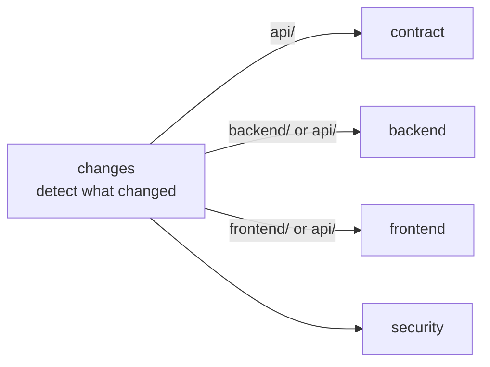

# Continuous Integration (CI)

**English** · [Español](ci.es.md)

This document explains how Nexo's CI on GitHub Actions works: when it runs, what each job checks, how to reproduce a failure locally and how it fits with the rules of the `main` branch.

The workflows live in [`.github/workflows/`](../.github/workflows/):

| File | Purpose |
|---|---|
| [`ci.yml`](../.github/workflows/ci.yml) | Main pipeline: contract, backend, frontend and security |
| [`codeql.yml`](../.github/workflows/codeql.yml) | Static security analysis of the code (GitHub CodeQL) |
| [`dependabot.yml`](../.github/dependabot.yml) | Automatic dependency update pull requests |

## When does it run?

```yaml
on:
  pull_request:
    branches: [main]
  push:
    branches: [main]
```

| Situation | Runs? |
|---|---|
| You push commits to a branch with no open pull request | ❌ No |
| You open a pull request to `main` | ✅ Yes |
| You push more commits to a branch with an open pull request to `main` | ✅ Yes, again, on the new state |
| A pull request is merged into `main` | ✅ Yes, once, on `main` with the merge applied |

Two details:

- **In a pull request, GitHub tests the result of merging your branch into `main`**, not your branch on its own. Problems that only appear when both are combined show up before the merge.
- **The run on `main` after each merge** catches the case where two pull requests pass separately but conflict with each other. It will also be the starting point for continuous deployment (CD).

### Cancelling obsolete runs

```yaml
concurrency:
  group: ci-${{ github.ref }}
  cancel-in-progress: true
```

If you push a new commit while the previous run is still in progress on the same branch, the old one is cancelled. Only the latest state matters, and it saves minutes.

### Permissions

The workflow runs with `contents: read` by default (it can read the code but not modify the repository). Only the job that detects changes also gets `pull-requests: read`. This is the principle of least privilege: if a dependency or action were compromised, it could not write to the repository.

## Pipeline overview



The first job detects **which parts of the monorepo changed** and the rest only run when relevant. A change only in the frontend does not run the Go tests, and vice versa. A change to `api/openapi.yaml` affects everything, because both the server and the client are generated from it. Changes to `ci.yml` itself run the backend and frontend jobs, so editing the pipeline also tests it.

Jobs that do not apply appear as **skipped** in GitHub, which counts as success for required checks.

## Jobs

### 1. `changes` — Detect changes

Uses [`dorny/paths-filter`](https://github.com/dorny/paths-filter) to compare the modified files against these filters:

| Output | Paths |
|---|---|
| `api` | `api/**`, `redocly.yaml` |
| `backend` | `backend/**`, `api/**`, `docker/**`, `.github/workflows/ci.yml` |
| `frontend` | `frontend/**`, `api/**`, `.github/workflows/ci.yml` |

### 2. `contract` — API contract

Runs when `api/` changes.

| Step | What it checks | Why |
|---|---|---|
| **Lint OpenAPI** | [Redocly CLI](https://redocly.com/docs/cli/) validates `api/openapi.yaml` with the rules in [`redocly.yaml`](../redocly.yaml) | The contract is the source of truth: a broken or ambiguous contract produces broken code on both sides |
| **Breaking changes against `main`** | [oasdiff](https://github.com/oasdiff/oasdiff) compares the contract with the one on `main` and fails if a change breaks existing clients (removing an endpoint or field, making a parameter required, changing a type…) | Today it looks like a detail; once there is a public API, an MCP server and integrations, breaking the API breaks other people's software |

If `main` has no contract yet, the breaking-change step is skipped.


### 3. `backend` — Go backend

Runs when `backend/` or `api/` changes. All steps run inside `backend/`.

| Step | What it checks |
|---|---|
| **Generated code is up to date** | Runs `go generate ./...` (oapi-codegen) and `go tool mockery` (test mocks), and fails if anything changes or new files appear. It catches a contract, query or interface that was modified without regenerating the code. |
| **Lint** | [golangci-lint](https://golangci-lint.run/) with the configuration in [`backend/.golangci.yml`](../backend/.golangci.yml), including `depguard`, which restricts where pgx, Firebase and Gin may be imported. |
| **Unit tests** | `go test -race ./...`. Includes [`arch_test.go`](../backend/arch_test.go), which checks the dependency rules between packages (a module never imports another one, only `internal/app` knows the concrete implementations…). |
| **Firebase emulator image** | Builds `docker/firebase`, used by the integration tests. |
| **Integration tests** | `go test -race -tags integration ./...`. Starts a real PostgreSQL and the Firebase Auth emulator with [testcontainers](https://golang.testcontainers.org/) (GitHub runners have Docker) and applies the migrations. |
| **Build** | `go build ./cmd/api`. |
| **Docker image** | Builds the image with [`backend/Dockerfile`](../backend/Dockerfile) (it is not published yet). It makes sure the image still builds. |

The Go version comes from `backend/go.mod`, so local and CI always use the same one.

### 4. `frontend` — React frontend

Runs when `frontend/` or `api/` changes. All steps run inside `frontend/`.

| Step | What it checks |
|---|---|
| **Install** | `pnpm install --frozen-lockfile`: fails if `pnpm-lock.yaml` does not match `package.json`. Builds are reproducible. |
| **Generated code is up to date** | Runs `pnpm generate` (orval client + TanStack Router route tree) and fails if anything changes. |
| **Lint** | ESLint, including the rules that prevent importing Firebase outside `shared/platform` and importing a feature's internals. |
| **Format** | Prettier in check mode. |
| **Types** | `tsc -b`. |
| **Tests** | Vitest. |
| **Build** | `vite build`. |

The pnpm version comes from the `packageManager` field in `frontend/package.json`.

### 5. `security` — Security

Always runs.

| Step | Tool | When |
|---|---|---|
| **Leaked secrets** | [gitleaks](https://github.com/gitleaks/gitleaks) scans the commits for keys, tokens or passwords | Always |
| **Go vulnerabilities** | [govulncheck](https://go.dev/blog/govulncheck): only reports vulnerabilities in code that is **actually called**, not just present in a dependency | If the backend changed |
| **npm vulnerabilities** | `pnpm audit --prod --audit-level high`: production dependencies with high or critical vulnerabilities | If the frontend changed |

## CodeQL

[`codeql.yml`](../.github/workflows/codeql.yml) runs GitHub's semantic code analysis on Go and TypeScript. It looks for vulnerability patterns (injections, unvalidated input reaching dangerous places, etc.).

- It runs on pull requests to `main`, on pushes to `main` and **every Monday**, so new rules are applied to unchanged code too.
- Results appear in the repository's **Security → Code scanning** tab.
- It is free because the repository is public.

## Dependabot

[`dependabot.yml`](../.github/dependabot.yml) opens pull requests to update dependencies. Each one goes through the full CI like any other change.

| Ecosystem | Folder | Frequency | Grouping |
|---|---|---|---|
| Go modules | `backend/` | Weekly | All in a single pull request |
| npm | `frontend/` | Weekly | Minor and patch updates together; majors separately, to review them one by one |
| GitHub Actions | `/` | Monthly | — |
| Docker | `backend/` | Monthly | — |
| Docker | `docker/firebase/` | Monthly | Node majors ignored: they follow `.nvmrc` and are bumped by hand |

## Before CI: local git hooks

[`lefthook.yml`](../lefthook.yml) (installed with `make setup`) runs fast checks before each commit, so most problems never reach CI:

- **pre-commit:** `gofmt` and `go vet` for Go files; ESLint and Prettier for frontend files. Only on the files being committed.
- **commit-msg:** checks that the message follows [Conventional Commits](https://www.conventionalcommits.org/) (`feat(tasks): …`, `fix(api): …`).

## Reproducing a failure locally

| Failed job / step | Local command |
|---|---|
| contract → Lint OpenAPI | `npx @redocly/cli lint api/openapi.yaml` |
| contract → Breaking changes | `git show origin/main:api/openapi.yaml > /tmp/base.yaml` and then `go run github.com/oasdiff/oasdiff@latest breaking /tmp/base.yaml api/openapi.yaml` |
| backend / frontend → Generated code | `make generate` and commit the changes |
| backend → Lint | `cd backend && golangci-lint run` |
| backend → Unit tests | `make test` |
| backend → Integration tests | `make test-integration` (needs Docker) |
| frontend → Lint, format, types | `make lint` (or `pnpm lint`, `pnpm format:check`, `pnpm typecheck` in `frontend/`) |
| frontend → Format | `make fmt` to fix it |
| frontend → Tests | `cd frontend && pnpm test` |
| security → govulncheck | `cd backend && go run golang.org/x/vuln/cmd/govulncheck@latest ./...` |

## Protecting the `main` branch

Recommended settings in **Settings → Branches** (or **Rules → Rulesets**) for `main`:

- **Require a pull request before merging.**
  - While there is a single contributor: **0 required approvals**. GitHub does not allow the author of a pull request to approve it, so requiring 1 would block your own pull requests.
  - When more people join: 1 approval plus a `CODEOWNERS` file, so review is requested automatically.
- **Require status checks to pass**: select the `Backend`, `Frontend`, `API contract` and `Security` jobs. GitHub only lists checks that have run at least once, so this is configured after the first pull request.
- **Require branches to be up to date before merging** (optional): forces the pull request to be retested with the latest `main`.
- **Do not allow force pushes or deletions.**

## Cost

The repository is public, so **GitHub Actions minutes are unlimited**. If it ever became private, the free plan includes 2,000 minutes per month. Path filters and the cancellation of obsolete runs keep a typical pull request at about 5–8 minutes.

## Coming next

- **End-to-end tests (`e2e`):** added once the first real flow exists (sign in + create a task). They will start the full environment with Docker Compose and the seed data, and run [Playwright](https://playwright.dev/) with accessibility checks ([axe](https://github.com/dequelabs/axe-core)).
- **Continuous deployment (CD):** after each merge to `main`, build the image, publish it to Artifact Registry and deploy it to Cloud Run. Authentication with GCP will use **Workload Identity Federation**, with no JSON keys stored in GitHub.
- **CLA:** a bot that asks external contributors to sign the agreement in their first pull request.
