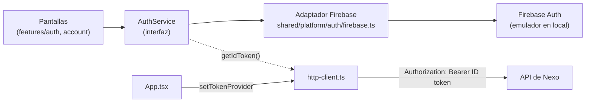
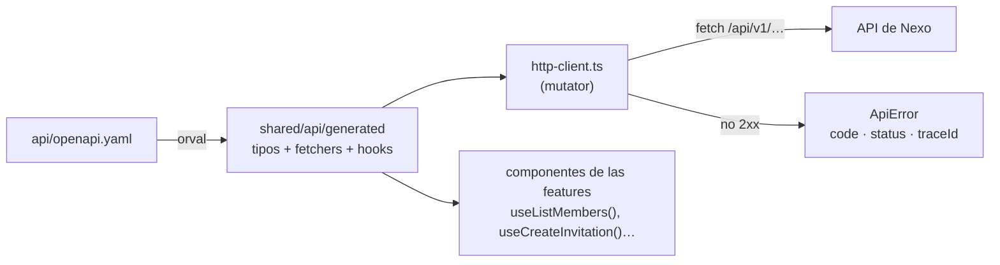

# Arquitectura del frontend

[English](README.md) · **Español**

Cómo está construida la aplicación web de Nexo: tecnologías, estructura, cómo llegan los datos de la API a la pantalla, cómo funciona la autenticación y las reglas que la mantienen coherente. El *porqué* de cada decisión está en el [registro de decisiones de arquitectura (ADR)](adr/README.es.md).

> **Estado:** la app cubre todo el primer hito: inicio de sesión y registro (email/contraseña y Google), crear y cambiar de espacio de trabajo, los miembros de un espacio con sus roles y las invitaciones (por email y por enlace). Proyectos y tareas llegan en el hito M1. Lo marcado como *previsto* está decidido pero aún no construido.

**Relacionado:** [Arquitectura del backend](../backend/README.es.md) · [Autenticación y usuarios (backend)](../backend/auth.es.md) · [CI](../ci.es.md)

---

## 1. Visión general

Una **aplicación de una sola página en React**, construida con **Vite** y servida como ficheros estáticos. Habla solo con la API de Nexo mediante un **cliente generado desde el contrato OpenAPI**, guarda los datos del servidor en **TanStack Query**, enruta con **TanStack Router**, autentica con **Firebase Authentication** tras un adaptador y es **bilingüe** (español e inglés) desde el principio.

Principios (de la visión del producto):

| Principio | Qué implica para el frontend |
|---|---|
| **La velocidad es una funcionalidad** | Estado del servidor en caché, carga de código por ruta; actualizaciones optimistas *(previsto)* |
| **Teclado primero, ratón también** | Todo funciona con teclado; atajos y paleta de comandos (`Ctrl+K`) *(previsto)* |
| **Todo es enlazable** | Las vistas viven en la URL, con parámetros tipados |
| **Simple por defecto** | La configuración nunca estorba al flujo principal |
| **El idioma de cada persona** | «Tareas» y «proyectos», no jerga; español e inglés, cambiables en cualquier momento |
| **Accesible** | Campos con etiqueta, errores anunciados, foco visible, enlace para saltar al contenido, navegación por teclado |

## 2. Stack tecnológico

| Aspecto | Tecnología | Estado |
|---|---|---|
| Librería de UI | React 19 | ✅ |
| Build / servidor de desarrollo | Vite 8 | ✅ |
| Lenguaje | TypeScript 6, estricto | ✅ |
| Enrutado | TanStack Router (basado en ficheros) | ✅ |
| Estado del servidor | TanStack Query 5 | ✅ |
| Estado de UI | Zustand 5 | ✅ (instalado, se usará cuando haga falta) |
| Cliente de la API | orval (generado desde `api/openapi.yaml`) | ✅ |
| Autenticación | SDK JS de Firebase Auth (modular), tras un adaptador | ✅ |
| Formularios y validación | react-hook-form + Zod | ✅ |
| Estilos | Tailwind CSS 4 + componentes pequeños propios en `shared/ui` | ✅ |
| Overlays accesibles (diálogos, menús), arrastrar y soltar, paleta de comandos | Primitivas de Radix, dnd-kit, cmdk | *previsto* (cuando una pantalla lo necesite) |
| i18n | i18next + react-i18next | ✅ |
| Tests unitarios/de componentes | Vitest + Testing Library (jsdom) | ✅ |
| End-to-end / accesibilidad | Playwright + axe | ✅ |
| Lint / formato | ESLint 10 (typescript-eslint), Prettier (+ plugin de Tailwind) | ✅ |
| Runtime / gestor de paquetes | Node 24 LTS (`.nvmrc`), pnpm (fijado en `package.json`) | ✅ |

## 3. Estructura del proyecto

```
frontend/
├── index.html
├── vite.config.ts          Plugins (router, React, Tailwind), alias `@`, proxy de desarrollo, Vitest
├── orval.config.ts         Generación del cliente de la API (+ Prettier sobre la salida)
├── tsr.config.json         Generación del árbol de rutas (mismos ajustes que el plugin de Vite)
├── eslint.config.js        Reglas de lint, incluidos los límites de importación
├── playwright.config.ts    Tests end-to-end: arranca la API y la app web
├── e2e/                    Specs y helpers de Playwright (comprobaciones de accesibilidad con axe)
└── src/
    ├── main.tsx            El único sitio donde se crea el proveedor de identidad
    ├── app/
    │   ├── App.tsx         Providers, proveedor de token del cliente API, vaciado de caché al cambiar de usuario
    │   ├── AppShell.tsx    Cabecera, navegación del espacio y marco de las páginas con sesión
    │   ├── CenteredLayout.tsx   Marco sencillo para inicio de sesión e invitaciones
    │   ├── guards.ts       Guards de ruta (requireAuth, redirectIfSignedIn)
    │   ├── safe-redirect.ts     Valida la redirección posterior al login (sin redirecciones abiertas)
    │   ├── router.ts       Instancia del router y contexto (QueryClient, auth)
    │   ├── query-client.ts Valores por defecto de TanStack Query
    │   ├── routes/         Rutas por ficheros: finas, renderizan una feature
    │   └── routeTree.gen.ts     Generado: no editar
    ├── features/           Una carpeta por feature; API pública mediante index.ts
    │   ├── account/        Aviso de verificación, selector de idioma, menú de usuario
    │   ├── auth/           Página de inicio de sesión / registro / recuperar contraseña
    │   ├── invitations/    Formulario de invitar, invitaciones pendientes, página de aceptar
    │   ├── system/         Indicador de conexión con la API
    │   └── workspaces/     Crear, cambiar, inicio, miembros
    ├── shared/
    │   ├── api/            Cliente generado, mutator HTTP (token, ApiError), mensajes de error
    │   ├── platform/       Adaptadores a servicios de terceros
    │   │   ├── auth/       Interfaz AuthService + implementación Firebase + bindings de React
    │   │   └── i18n/       Configuración de i18next y locales (es, en)
    │   ├── ui/             Button, Input, Select, Field, Alert, Card, Spinner
    │   ├── forms.ts · format.ts · roles.ts · storage.ts   Utilidades compartidas pequeñas
    └── test/               Auth falso, API falsa, fixtures, renderApp
```

**¿Dónde va el código nuevo?**

| Es… | Va en |
|---|---|
| Una pantalla o comportamiento de un área del producto (tablero, tareas, invitaciones) | `features/<feature>/` |
| Una URL | `app/routes/` — fina: renderiza un componente de una feature |
| Un componente visual reutilizable sin conocimiento de negocio | `shared/ui/` |
| Acceso a un SDK de terceros (Firebase, analítica…) | `shared/platform/<servicio>/` |
| Una llamada a la API | En ningún sitio a mano: usa los hooks generados de `shared/api/generated` |

Las features nunca importan las partes internas de otra, solo su `index.ts`; y dos features no deben depender una de otra en círculo (lo compartido va a `shared/`).

## 4. Arranque y providers

`main.tsx` crea el **servicio de auth** (`createFirebaseAuth(readFirebaseConfig())`) y renderiza `<App auth={auth} />`. `App`:

- crea **un `QueryClient`** y **un router** (el contexto del router lleva el `QueryClient` y el servicio de auth);
- registra el **proveedor de token** del cliente de la API, para que cada petición lleve el ID token;
- **vacía la caché de consultas cuando cambia la cuenta con sesión** (inicio, cierre, cambio de cuenta), para que nadie vea datos en caché de otra persona;
- lo envuelve todo en `AuthProvider` y `QueryClientProvider`.

Valores por defecto de las consultas: `staleTime` de 30 s; **los errores 4xx no se reintentan**; los de red y 5xx se reintentan hasta dos veces. Las devtools solo se renderizan en desarrollo.

## 5. Rutas y guards

| Ruta | Página | Acceso |
|---|---|---|
| `/login?redirect=…` | Iniciar sesión, crear cuenta, recuperar contraseña | Pública; quien ya tiene sesión pasa a `redirect` |
| `/invitations/$token` | Ver y aceptar una invitación | Requiere sesión |
| `/` | Lleva al último espacio usado, al primero, o a crear el primero | Requiere sesión |
| `/workspaces/new` | Crear un espacio de trabajo | Requiere sesión |
| `/workspaces/$workspaceId` | Inicio del espacio | Miembro |
| `/workspaces/$workspaceId/members` | Miembros, roles e invitaciones | Miembro (gestionar: administradores) |

- Las rutas son **ficheros** en `src/app/routes`; `_app.tsx` es un *layout sin ruta* que envuelve todas las páginas con sesión con el `AppShell` y el guard. El plugin del router genera `routeTree.gen.ts`; cada ruta se **divide en chunks** automáticamente.
- Los **guards** (`guards.ts`) se ejecutan en `beforeLoad`: esperan al estado inicial de autenticación y redirigen a quien no tiene sesión a `/login?redirect=<a dónde iba>`.
- **`safeRedirect`** solo acepta rutas de esta app en el parámetro `redirect`: `https://evil.example`, `//evil.example`, barras invertidas y caracteres de control se ignoran. Sin esto, un enlace de login manipulado podría enviar a un sitio malicioso justo después de autenticarse.
- Las páginas de un espacio las envuelve `WorkspaceLayout`, que carga el espacio una vez, explica el error si la persona no puede abrirlo (la API responde 404 a quien no es miembro) y lo recuerda como el último usado.

## 6. Autenticación



- **`AuthService`** (`shared/platform/auth/types.ts`) es todo lo que la app necesita de un proveedor de identidad: el estado (`getSnapshot`/`subscribe`, usado con `useAuth()` y `useSyncExternalStore`), `ready()`, `getIdToken()` y las acciones (inicio/alta con contraseña, Google, cierre de sesión, recuperar contraseña, email de verificación, `refreshUser`). Solo `firebase.ts` importa el SDK (ESLint lo impone).
- **El alta** crea la cuenta, fija el nombre, obtiene un **token nuevo que ya lleva el nombre** y envía el **email de verificación**. La API crea el perfil del usuario en la primera petición autenticada, así que no hay que llamar a nada más.
- **Los errores** se traducen de los códigos del SDK a los nuestros (`INVALID_CREDENTIALS`, `EMAIL_IN_USE`, …); la UI muestra `auth.errors.<CODE>`. Cerrar la ventana de Google no es un error.
- **Verificación del email:** quien se registra con contraseña ve un aviso hasta que verifica. Importa porque **aceptar una invitación por email exige un email verificado**. «Ya lo he verificado» recarga la cuenta *y renueva el token*, porque la API lee `email_verified` del token.
- **Token hacia la API:** el cliente HTTP pide el ID token al proveedor en cada petición. Si la API responde `INVALID_TOKEN` (token caducado), pide un **token nuevo y reintenta una vez**.
- **Cerrar sesión** lleva a `/login` y vacía la caché.

## 7. Hablar con la API



- **Nunca escribas llamadas fetch ni tipos de la API a mano.** `pnpm generate` (o `make generate`) regenera el cliente desde el contrato y lo formatea; el CI falla si está desactualizado.
- Cada operación produce un fetcher y un hook de TanStack Query. Tras una mutación, las features invalidan las consultas afectadas con los helpers generados `get…QueryKey()`.
- Todas las peticiones pasan por **un único mutator** ([`http-client.ts`](../../frontend/src/shared/api/http-client.ts)): añade el token y devuelve el cuerpo ya interpretado, o lanza **`ApiError`** con el `code` del backend, el `status`, el `traceId` y el `problem` completo (`UNEXPECTED_RESPONSE` para otros cuerpos de error, `NETWORK_ERROR` con status 0 si no se puede enviar; las peticiones abortadas se relanzan sin tocar).
- En desarrollo, Vite hace de proxy de `/api` hacia `http://localhost:8080`: mismo origen, sin CORS.

## 8. Errores y traducciones

- Los mensajes viven en `shared/platform/i18n/locales/{es,en}.json`. El idioma es el que eligió la persona (se recuerda en `localStorage` y el atributo `lang` de la página lo sigue) o, la primera vez, el del navegador (español si empieza por `es`).
- **Los errores del backend se traducen por su código**: `useErrorMessage()` convierte un `ApiError` en `t('errors.<CODE>')`, con un mensaje genérico de respaldo. Cada código nuevo del backend necesita una entrada en ambos ficheros.
- Las pantallas de error pueden mostrar el **código de traza** (`traceId`) para que los usuarios lo comuniquen y el equipo encuentre la línea exacta del log.

## 9. Formularios

- **react-hook-form + Zod** (`zodResolver`). Los esquemas usan **claves de traducción como mensajes de error** (`'validation.required'`), y `useFieldError()` las traduce al mostrarse, así los mensajes siguen el idioma actual.
- `Field` (en `shared/ui`) pinta la etiqueta, el control, una ayuda y el error, conectados con `id`, `aria-invalid` y `aria-describedby`; los errores se anuncian con `role="alert"`.
- Los errores del servidor (un `Problem`) se muestran en un `Alert` sobre el formulario.
- La validación en el formulario es una comodidad: la API valida de nuevo y tiene la última palabra.

## 10. Gestión de estado

| Estado | Dónde | Ejemplo |
|---|---|---|
| Datos del servidor | TanStack Query (hooks generados) | espacios, miembros, invitaciones, el usuario actual |
| Autenticación | `AuthService` (vía `useAuth()`) | quién tiene sesión, email verificado |
| Estado en la URL | Parámetros del router | espacio actual, `redirect` |
| Estado de UI compartido | Store de Zustand *(previsto)* | paleta de comandos abierta, barra lateral plegada |
| Estado de UI local | `useState` en el componente | una confirmación visible |
| Comodidades por persona | `localStorage` con `safeStorage` | idioma, último espacio |

Los datos del servidor **nunca se copian** a Zustand ni al estado de un componente: se leen de la caché de consultas. `safeStorage` nunca lanza (puede no estar disponible o estar lleno) y nada que deba persistir de verdad vive ahí.

## 11. Estilos y componentes de UI

- **Tailwind CSS 4** mediante su plugin de Vite; Prettier ordena las clases; `cn()` (clsx + tailwind-merge) las une.
- **`shared/ui`** contiene componentes pequeños propios al estilo shadcn: `Button` (variantes, `loading`), `Input`, `Select` (nativo), `Field`, `Alert`, `Card`, `Spinner`. Radix, dnd-kit y cmdk se añadirán cuando una pantalla necesite un diálogo, un menú, arrastrar y soltar o la paleta de comandos ([ADR-0012](adr/0012-ui-primitives-and-forms.es.md)).
- **La accesibilidad es un requisito:** todo control tiene etiqueta, los errores se anuncian, el foco es visible, hay un enlace de *saltar al contenido*, se prefieren los controles nativos, las acciones destructivas piden confirmación y el diseño funciona desde 375 px de ancho (las tablas se desplazan dentro de su tarjeta).

## 12. Adaptadores de plataforma y reglas de importación

Los servicios de terceros se envuelven en `shared/platform`, igual que los adaptadores del backend ([ADR-0006](adr/0006-feature-structure-and-adapters.es.md)):

| Adaptador | Estado |
|---|---|
| `i18n` (i18next) | ✅ |
| `auth` (Firebase Auth) | ✅ ([ADR-0011](adr/0011-frontend-authentication.es.md)) |
| `realtime` (señales de Firestore → invalidación de consultas) | *previsto* |

ESLint impone los límites:

- importar `firebase` fuera de `src/shared/platform/**` es un **error**;
- importar las partes internas de una feature (`@/features/x/y`) en vez de su `index.ts` público es un **error**;
- los ficheros generados se excluyen del lint; el cliente de la API se formatea con Prettier justo tras generarlo (hook de orval), así los cambios de contrato producen diffs limpios.

## 13. Configuración

Ajustes públicos de compilación, como variables `VITE_*` ([`frontend/.env.example`](../../frontend/.env.example)):

| Variable | Descripción |
|---|---|
| `VITE_FIREBASE_API_KEY` | Clave web de Firebase (no es secreta). Obligatoria en builds de producción |
| `VITE_FIREBASE_PROJECT_ID` | Proyecto de Firebase. Obligatoria en builds de producción |
| `VITE_FIREBASE_AUTH_DOMAIN` | Opcional; necesaria para la ventana de Google en producción |
| `VITE_FIREBASE_AUTH_EMULATOR_URL` | Emulador de Auth. En desarrollo vale `http://localhost:9099` por defecto; **una build de producción se niega a arrancar con ella** (el emulador acepta tokens sin firmar) |

En desarrollo no hay que configurar nada: todo apunta por defecto al emulador local (`make up`). Los secretos nunca viven en el frontend.

`vite.config.ts`: servidor de desarrollo en el puerto 5173, proxy de `/api` a `localhost:8080`, `@` → `src`.

## 14. Tests

| Nivel | Herramienta | Qué |
|---|---|---|
| Unidades y componentes | Vitest + Testing Library + jsdom | El cliente HTTP (token, reintento), la configuración, el mapeo de errores, `safeRedirect` |
| Pantallas y flujos | Lo mismo, con el **router y los guards reales** | Inicio/alta, crear espacio, miembros, invitaciones, aviso de verificación, idioma |
| End-to-end y accesibilidad | Playwright + axe contra la API real, PostgreSQL y el emulador de Auth, con los datos de ejemplo (`make e2e`) | ✅ |

Utilidades en `src/test`: **`createFakeAuth()`** (un `AuthService` que registra cada acción), **`mockApi()`** (sustituye `fetch` por una API falsa indexada por `"MÉTODO /ruta"` y registra las peticiones inesperadas), **fixtures** y **`renderApp({ path, auth })`**, que monta toda la app sobre un historial en memoria. Los tests se escriben desde el punto de vista de quien usa la app (etiquetas, roles, textos), no de los detalles de implementación, y se ejecutan en español.

## 15. Controles de calidad

| Comando | Qué |
|---|---|
| `pnpm lint` | ESLint, con límites de importación y comprobaciones de React Compiler |
| `pnpm format:check` | Prettier (incluido el cliente generado) |
| `pnpm typecheck` | `tsc -b` (tests incluidos) |
| `pnpm test` | Vitest |
| `pnpm build` | Bundle de producción |
| `pnpm generate` | Cliente de la API + árbol de rutas (el CI comprueba que están al día) |
| `pnpm e2e` / `make e2e` | Tests end-to-end con Playwright + axe (necesita `make up`; el objetivo del Makefile también migra y carga los datos) |

Todos corren en el CI en los pull requests que tocan `frontend/` o `api/`. Los hooks de git (lefthook) ejecutan ESLint y Prettier sobre los ficheros en stage.

## 16. Desarrollo local

```bash
nvm use            # Node 24 de .nvmrc
make up            # PostgreSQL, emulador de Firebase Auth, Mailpit
make db-seed       # cuentas y espacios de ejemplo (ana@nexo.local, contraseña nexo1234)
make dev-api       # API en :8080
make dev-web       # web en http://localhost:5173
```

Todo se puede probar sin ninguna cuenta en la nube:

- **Regístrate** en la app; la cuenta se crea en el emulador de Auth (usuarios y enlaces de verificación: <http://localhost:4000>).
- **Los emails de invitación** llegan a Mailpit: <http://localhost:8025>.
- Para verificar un email en local, abre su enlace de verificación desde la UI del emulador (Authentication → la cuenta) y pulsa «Ya lo he verificado» en la app.

## 17. Próximos pasos

| Elemento | Cuándo |
|---|---|
| ✅ Datos de ejemplo (`make db-seed`) | Hecho |
| ✅ El CLA | Hecho |
| ✅ Playwright + axe en el CI con el primer flujo completo | Hecho |
| Proyectos, tareas, vistas de tablero y lista (+ dnd-kit, cmdk, overlays de Radix según haga falta) | Hito M1 |
| Actualizaciones optimistas, paleta de comandos, atajos | Con el tablero |
| Invalidación en tiempo real mediante señales de Firestore | Cuando el backend publique señales |
