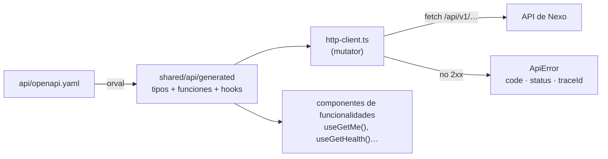

# Arquitectura del frontend

[English](README.md) · **Español**

Cómo está construida la aplicación web de Nexo: tecnologías, estructura, cómo llegan los datos de la API a la pantalla y las reglas que la mantienen coherente. El *porqué* de cada decisión está en el [registro de decisiones de arquitectura (ADR)](adr/README.es.md).

> **Estado:** hoy el frontend es un esqueleto (una página que indica si la API responde). Los cimientos que se describen aquí ya están montados; las primeras pantallas reales (inicio de sesión, alta del espacio de trabajo, invitaciones) llegan al final del hito M0. Lo marcado como *previsto* está decidido pero aún no construido.

**Relacionado:** [Arquitectura del backend](../backend/README.es.md) · [CI](../ci.es.md)

---

## 1. Visión general

Una **aplicación de una sola página en React**, construida con **Vite** y servida como ficheros estáticos. Solo habla con la API de Nexo, mediante un **cliente generado a partir del contrato OpenAPI**; guarda los datos del servidor en **TanStack Query**, gestiona las rutas con **TanStack Router** y es **bilingüe** (español e inglés) desde el principio.

Principios (de la visión del producto):

| Principio | Qué significa para el frontend |
|---|---|
| **La rapidez es una funcionalidad** | Actualizaciones optimistas, datos del servidor en caché, código dividido por rutas |
| **Teclado primero, ratón también** | Cada acción tiene atajo y una paleta de comandos (`Ctrl+K`), pero nada *exige* conocer atajos |
| **Todo es enlazable** | Las vistas y los filtros viven en la URL, con parámetros de búsqueda tipados |
| **Simple por defecto** | La configuración nunca se interpone en el flujo principal |
| **El lenguaje de todos** | «Tareas» y «proyectos», sin jerga; español e inglés |
| **Accesible** | Navegación por teclado y contraste AA; primitivas de Radix |

## 2. Tecnologías

| Aspecto | Tecnología | Estado |
|---|---|---|
| Librería de interfaz | React 19 | ✅ |
| Herramienta de build / servidor de desarrollo | Vite 8 | ✅ |
| Lenguaje | TypeScript 6, estricto | ✅ |
| Rutas | TanStack Router (basado en ficheros) | ✅ |
| Estado del servidor | TanStack Query 5 | ✅ |
| Estado de la interfaz | Zustand 5 | ✅ (instalado; se usa cuando haga falta) |
| Cliente de la API | orval (generado desde `api/openapi.yaml`) | ✅ |
| Estilos | Tailwind CSS 4 | ✅ |
| Componentes | shadcn/ui (Radix), dnd-kit, cmdk | *previsto* |
| Idiomas | i18next + react-i18next | ✅ |
| Formularios | react-hook-form + Zod | *previsto* |
| Autenticación | SDK JS de Firebase Auth (detrás de un adaptador) | *previsto* |
| Tests unitarios y de componentes | Vitest + Testing Library (jsdom) | ✅ |
| De punta a punta / accesibilidad | Playwright + axe, MSW | *previsto* |
| Lint / formato | ESLint 10 (typescript-eslint), Prettier (+ plugin de Tailwind) | ✅ |
| Entorno / gestor de paquetes | Node 24 LTS (`.nvmrc`), pnpm (fijado en `package.json`) | ✅ |

## 3. Estructura del proyecto

```
frontend/
├── index.html
├── vite.config.ts          Plugins (router, React, Tailwind), alias `@`, proxy de desarrollo, Vitest
├── orval.config.ts         Generación del cliente de la API
├── tsr.config.json         Generación del árbol de rutas (misma configuración que el plugin de Vite)
├── eslint.config.js        Reglas de lint, incluidas las fronteras de imports
└── src/
    ├── main.tsx            Monta la aplicación y carga i18n y estilos
    ├── styles.css          Punto de entrada de Tailwind
    ├── app/
    │   ├── App.tsx         Providers: QueryClient y Router
    │   ├── query-client.ts Valores por defecto de TanStack Query (reintentos, tiempo de caché)
    │   ├── router.ts       Instancia del router y su contexto (QueryClient)
    │   ├── routes/         Rutas basadas en ficheros (__root.tsx, index.tsx…)
    │   └── routeTree.gen.ts   Generado: no se edita
    ├── features/           Una carpeta por funcionalidad; su API pública en index.ts
    │   └── system/         HealthStatus (indicador de conexión con la API)
    ├── shared/
    │   ├── api/
    │   │   ├── generated/  Generado por orval: no se edita
    │   │   ├── http-client.ts      Mutator de las peticiones y ApiError
    │   │   └── use-error-message.ts  Código de error → mensaje traducido
    │   ├── platform/       Adaptadores a servicios de terceros
    │   │   └── i18n/       Configuración de i18next y textos (es, en)
    │   └── ui/             Componentes compartidos (shadcn/ui, previsto)
    └── test/               Configuración y utilidades de los tests
```

**¿Dónde va el código nuevo?**

| Si es… | Va en |
|---|---|
| Una pantalla o un comportamiento de un área del producto (tablero, tareas, invitaciones) | `features/<funcionalidad>/` |
| Una URL | `app/routes/`, ligera: solo renderiza un componente de una funcionalidad |
| Un componente visual reutilizable sin conocimiento de negocio | `shared/ui/` |
| El acceso a un SDK de terceros (Firebase, analítica…) | `shared/platform/<servicio>/` |
| Una llamada a la API | En ningún sitio a mano: se usan los hooks generados de `shared/api/generated` |

## 4. Arranque y providers

`main.tsx` importa la configuración de i18n y los estilos, y renderiza `<App />`. `App` crea **un `QueryClient`** y **un router** por instancia de la aplicación y los proporciona:

- **Valores por defecto de las consultas** (`query-client.ts`): `staleTime` de 30 s; **los errores 4xx no se reintentan** (no se van a arreglar solos), y los errores de red y 5xx se reintentan hasta dos veces.
- **El contexto del router** lleva el `QueryClient`, para que las rutas puedan precargar datos.
- **Las devtools** del router y de TanStack Query solo se muestran en desarrollo.

## 5. Rutas

- Las rutas son **ficheros** en `src/app/routes`: `index.tsx` es `/` y `__root.tsx` es el layout que lo envuelve todo. Las carpetas anidadas y los ficheros `$param` crean rutas anidadas y dinámicas.
- El plugin del router genera `routeTree.gen.ts` (en desarrollo y al compilar; `pnpm generate` ejecuta `tsr generate` para el CI). Cada ruta se **divide en su propio trozo de código** automáticamente.
- Los parámetros y los **parámetros de búsqueda están tipados**: los filtros y las vistas se guardarán en la URL para que todo sea enlazable.
- Los ficheros de ruta son ligeros: declaran la ruta y renderizan un componente de una funcionalidad.

## 6. Comunicación con la API



- **Nunca se escriben a mano llamadas ni tipos de la API.** `pnpm generate` (o `make generate`) regenera el cliente a partir del contrato; el CI falla si no está al día.
- Cada operación genera una función de petición y un hook de TanStack Query (p. ej. `useGetHealth`, `useGetMe`).
- Todas las peticiones pasan por **un único mutator** ([`http-client.ts`](../../frontend/src/shared/api/http-client.ts)):
  - si va bien → devuelve el cuerpo ya interpretado;
  - si la respuesta es Problem Details → lanza **`ApiError`** con el `code`, el `status`, el `traceId` y el `problem` completo del backend;
  - si el cuerpo de error es otro → `ApiError` con `UNEXPECTED_RESPONSE`;
  - si falla la red → `ApiError` con `NETWORK_ERROR` y estado 0; las peticiones canceladas se relanzan sin tocar.
- `ApiError` es el tipo de error de todos los hooks generados, así que `error.code` y `error.traceId` están tipados.
- En desarrollo, Vite redirige `/api` a `http://localhost:8080`: mismo origen, sin CORS.
- *Previsto:* el adaptador de autenticación añadirá el ID token de Firebase a cada petición; los avisos en tiempo real invalidarán las consultas afectadas; las modificaciones usarán actualizaciones optimistas.

## 7. Errores y traducciones

- Los textos están en `shared/platform/i18n/locales/{es,en}.json`. El idioma se toma del navegador (español si empieza por `es`; si no, inglés).
- **Los errores del backend se traducen por su código**: `useErrorMessage()` convierte un `ApiError` en `t('errors.<CODE>')`, con un mensaje genérico de respaldo. Cada código nuevo del backend necesita su entrada en los dos ficheros de idioma.
- Las pantallas de error muestran el **código de seguimiento** (`traceId`) para que el usuario pueda comunicarlo y se encuentre la línea exacta del log.
- *Previsto:* los errores de validación de formularios (`errors[]` en Problem Details) se asignarán a cada campo con react-hook-form.

## 8. Gestión del estado

| Estado | Dónde | Ejemplo |
|---|---|---|
| Datos del servidor | TanStack Query (hooks generados) | tareas, proyectos, el usuario actual |
| Estado de la URL | Parámetros de búsqueda de TanStack Router | filtros, vista seleccionada, tarea abierta |
| Estado de interfaz compartido | Store de Zustand | paleta de comandos abierta, barra lateral plegada |
| Estado de interfaz local | `useState` en el componente | un desplegable abierto |

Los datos del servidor **nunca se copian** a Zustand ni al estado de un componente: se leen de la caché de consultas.

## 9. Estilos y componentes

- **Tailwind CSS 4** mediante su plugin de Vite; Prettier ordena las clases.
- *Previsto:* componentes de **shadcn/ui** (primitivas de Radix) copiados en `shared/ui`, **dnd-kit** para el tablero, **cmdk** para la paleta de comandos y diálogos y menús accesibles basados en Radix.
- La accesibilidad es un requisito: todo accesible por teclado, foco visible, contraste AA y `role`/ARIA donde haga falta (el indicador de conexión ya usa `role="status"`/`"alert"`).

## 10. Adaptadores de plataforma y reglas de imports

Los servicios de terceros se envuelven en `shared/platform`, igual que los adaptadores del backend ([ADR-0006](adr/0006-feature-structure-and-adapters.es.md)):

| Adaptador | Estado |
|---|---|
| `i18n` (i18next) | ✅ |
| `auth` (Firebase Auth: inicio de sesión, token, sesión actual) | *previsto* (hito M0) |
| `realtime` (escucha de avisos de Firestore → invalidación de consultas) | *previsto* |

ESLint hace cumplir las fronteras:

- importar `firebase` fuera de `src/shared/platform/**` es un **error**;
- importar las partes internas de una funcionalidad (`@/features/x/y`) en lugar de su `index.ts` es un **error**;
- los ficheros generados quedan fuera del lint y del formato.

## 11. Configuración

- `vite.config.ts`: servidor de desarrollo en el puerto 5173, proxy de `/api` a `localhost:8080`, `@` → `src`.
- *Previsto:* la configuración pública de compilación como variables `VITE_*` (configuración web de Firebase, dirección del emulador). Los secretos nunca viven en el frontend.

## 12. Tests

| Nivel | Herramienta | Estado |
|---|---|---|
| Unidades y componentes | Vitest + Testing Library + jsdom; `fetch` simulado; utilidad `renderWithProviders` | ✅ |
| Simulación de la API para tests de componentes más completos | MSW con mocks generados por orval | *previsto* |
| De punta a punta y accesibilidad | Playwright + axe contra Docker Compose con datos de prueba | *previsto* (con el primer flujo real) |

Los tests se escriben desde el punto de vista del usuario (textos, roles), no de los detalles de implementación. La configuración carga i18n en español para que las comprobaciones usen los mensajes reales.

## 13. Controles de calidad

| Comando | Qué hace |
|---|---|
| `pnpm lint` | ESLint, incluidas las fronteras de imports |
| `pnpm format:check` | Prettier |
| `pnpm typecheck` | `tsc -b` |
| `pnpm test` | Vitest |
| `pnpm build` | Paquete de producción |
| `pnpm generate` | Cliente de la API + árbol de rutas (el CI comprueba que están al día) |

Todos se ejecutan en el CI en los pull requests que tocan `frontend/` o `api/`. Los ganchos de git (lefthook) pasan ESLint y Prettier sobre los ficheros del commit.

## 14. Desarrollo local

```bash
nvm use            # Node 24 según .nvmrc
make up            # servicios del backend (PostgreSQL, emulador de Firebase)
make dev-api       # API en :8080
make dev-web       # web en http://localhost:5173
```

## 15. Próximos pasos

| Elemento | Cuándo |
|---|---|
| Adaptador de autenticación + pantallas de inicio de sesión y registro | Hito M0 (PR 5) |
| Alta del primer espacio de trabajo e interfaz de invitaciones | Hito M0 (PR 5) |
| Componentes base de shadcn/ui, estructura de la aplicación y paleta de comandos | Con las primeras pantallas |
| Formularios con react-hook-form + Zod y errores por campo desde Problem Details | Con los primeros formularios |
| Playwright + axe en el CI | Con el primer flujo completo |
| Invalidación en tiempo real con avisos de Firestore | Cuando el backend publique avisos |
