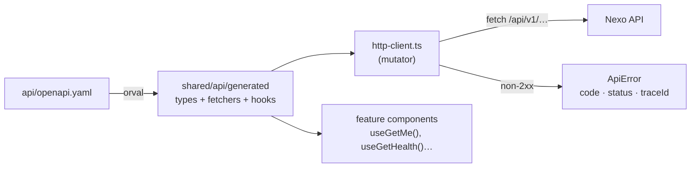

# Frontend architecture

**English** · [Español](README.es.md)

How the Nexo web app is built: technologies, structure, how data flows from the API to the screen, and the rules that keep it consistent. The *why* behind each choice is in the [Architecture Decision Records](adr/README.md).

> **Status:** the frontend is a skeleton today (a page that shows whether the API is reachable). The foundations described here are in place; the first real screens (sign-in, workspace creation, invitations) arrive at the end of milestone M0. Items marked *planned* are decided but not built yet.

**Related:** [Backend architecture](../backend/README.md) · [CI](../ci.md)

---

## 1. Overview

A **single-page application in React**, built with **Vite** and served as static files. It talks only to the Nexo API through a **client generated from the OpenAPI contract**, keeps server data in **TanStack Query**, routes with **TanStack Router** and is **bilingual** (Spanish and English) from the start.

Guiding principles (from the product vision):

| Principle | What it means for the frontend |
|---|---|
| **Speed is a feature** | Optimistic updates, cached server state, route-level code splitting |
| **Keyboard first, mouse too** | Every action has a shortcut and a command palette (`Ctrl+K`), but nothing *requires* shortcuts |
| **Everything is linkable** | Views and filters live in the URL, with typed search params |
| **Simple by default** | Configuration never sits in the way of the main flow |
| **Everyone's language** | "Tasks" and "projects", not jargon; Spanish and English |
| **Accessible** | Keyboard navigation and AA contrast; Radix primitives |

## 2. Technology stack

| Concern | Technology | Status |
|---|---|---|
| UI library | React 19 | ✅ |
| Build tool / dev server | Vite 8 | ✅ |
| Language | TypeScript 6, strict | ✅ |
| Routing | TanStack Router (file-based) | ✅ |
| Server state | TanStack Query 5 | ✅ |
| UI state | Zustand 5 | ✅ (installed, used when needed) |
| API client | orval (generated from `api/openapi.yaml`) | ✅ |
| Styling | Tailwind CSS 4 | ✅ |
| Components | shadcn/ui (Radix), dnd-kit, cmdk | *planned* |
| i18n | i18next + react-i18next | ✅ |
| Forms | react-hook-form + Zod | *planned* |
| Authentication | Firebase Auth JS SDK (behind an adapter) | *planned* |
| Unit/component tests | Vitest + Testing Library (jsdom) | ✅ |
| End-to-end / a11y | Playwright + axe, MSW | *planned* |
| Lint / format | ESLint 10 (typescript-eslint), Prettier (+ Tailwind plugin) | ✅ |
| Runtime / package manager | Node 24 LTS (`.nvmrc`), pnpm (pinned in `package.json`) | ✅ |

## 3. Project layout

```
frontend/
├── index.html
├── vite.config.ts          Plugins (router, React, Tailwind), `@` alias, dev proxy, Vitest
├── orval.config.ts         API client generation
├── tsr.config.json         Route tree generation (same settings as the Vite plugin)
├── eslint.config.js        Lint rules, including import boundaries
└── src/
    ├── main.tsx            Mounts the app, loads i18n and styles
    ├── styles.css          Tailwind entry point
    ├── app/
    │   ├── App.tsx         Providers: QueryClient, Router
    │   ├── query-client.ts TanStack Query defaults (retry policy, stale time)
    │   ├── router.ts       Router instance and context (QueryClient)
    │   ├── routes/         File-based routes (__root.tsx, index.tsx…)
    │   └── routeTree.gen.ts   Generated: do not edit
    ├── features/           One folder per feature; public API through index.ts
    │   └── system/         HealthStatus (API connection indicator)
    ├── shared/
    │   ├── api/
    │   │   ├── generated/  Generated by orval: do not edit
    │   │   ├── http-client.ts      Request mutator and ApiError
    │   │   └── use-error-message.ts  Error code → translated message
    │   ├── platform/       Adapters to third-party services
    │   │   └── i18n/       i18next setup and locales (es, en)
    │   └── ui/             Shared components (shadcn/ui, planned)
    └── test/               Test setup and helpers
```

**Where does new code go?**

| It is… | Put it in |
|---|---|
| A screen or behaviour of one product area (board, tasks, invitations) | `features/<feature>/` |
| A URL | `app/routes/` — thin: it renders a feature component |
| A reusable visual component with no business knowledge | `shared/ui/` |
| Access to a third-party SDK (Firebase, analytics…) | `shared/platform/<service>/` |
| An API call | Nowhere by hand: use the generated hooks from `shared/api/generated` |

## 4. Bootstrap and providers

`main.tsx` imports the i18n setup and the styles and renders `<App />`. `App` creates **one `QueryClient`** and **one router** per app instance and provides them:

- **Query defaults** (`query-client.ts`): `staleTime` 30 s; **4xx errors are not retried** (they will not fix themselves), network and 5xx errors are retried up to twice.
- **Router context** carries the `QueryClient`, so route loaders can prefetch data.
- **Devtools** for the router and TanStack Query are rendered only in development.

## 5. Routing

- Routes are **files** in `src/app/routes`: `index.tsx` is `/`, `__root.tsx` is the layout that wraps everything. Nested folders and `$param` files create nested and dynamic routes.
- The router plugin generates `routeTree.gen.ts` (in dev and build; `pnpm generate` runs `tsr generate` for CI). Each route is **code-split** automatically.
- Params and **search params are typed**: filters and views will be stored in the URL so every view is linkable.
- Route files stay thin: they declare the route and render a component from a feature.

## 6. Talking to the API



- **Never write fetch calls or API types by hand.** `pnpm generate` (or `make generate`) regenerates the client from the contract; CI fails if it is stale.
- Each operation produces a fetcher and a TanStack Query hook (e.g. `useGetHealth`, `useGetMe`).
- All requests go through **one mutator** ([`http-client.ts`](../../frontend/src/shared/api/http-client.ts)):
  - success → returns the parsed body;
  - Problem Details response → throws **`ApiError`** with the backend `code`, `status`, `traceId` and the full `problem`;
  - other error bodies → `ApiError` with `UNEXPECTED_RESPONSE`;
  - network failure → `ApiError` with `NETWORK_ERROR` and status 0; aborted requests are re-thrown untouched.
- `ApiError` is the error type of every generated hook, so `error.code` and `error.traceId` are typed.
- In development, Vite proxies `/api` to `http://localhost:8080`: same origin, no CORS.
- *Planned:* the auth adapter will attach the Firebase ID token to every request; real-time signals will invalidate the affected queries; mutations will use optimistic updates.

## 7. Errors and translations

- Messages live in `shared/platform/i18n/locales/{es,en}.json`. The language comes from the browser (Spanish if it starts with `es`, otherwise English).
- **Backend errors are translated by their code**: `useErrorMessage()` turns an `ApiError` into `t('errors.<CODE>')`, falling back to a generic message. Every new backend code needs an entry in both locale files.
- Error UIs show the **trace code** (`traceId`) so users can report it and developers can find the exact log line.
- *Planned:* form validation errors (`errors[]` in Problem Details) mapped to fields with react-hook-form.

## 8. State management

| State | Where | Example |
|---|---|---|
| Server data | TanStack Query (generated hooks) | tasks, projects, the current user |
| URL state | TanStack Router search params | filters, selected view, open task |
| Shared UI state | Zustand store | command palette open, sidebar collapsed |
| Local UI state | `useState` in the component | a dropdown being open |

Server data is **never copied** into Zustand or component state: read it from the query cache.

## 9. Styling and UI components

- **Tailwind CSS 4** through its Vite plugin; Prettier sorts classes.
- *Planned:* **shadcn/ui** components (Radix primitives) copied into `shared/ui`, **dnd-kit** for the board, **cmdk** for the command palette, Radix-based accessible dialogs and menus.
- Accessibility is a requirement: keyboard reachable, visible focus, AA contrast, `role`/ARIA where needed (the health indicator already uses `role="status"`/`"alert"`).

## 10. Platform adapters and import rules

Third-party services are wrapped in `shared/platform`, mirroring the backend adapters ([ADR-0006](adr/0006-feature-structure-and-adapters.md)):

| Adapter | Status |
|---|---|
| `i18n` (i18next) | ✅ |
| `auth` (Firebase Auth: sign-in, token, current session) | *planned* (milestone M0) |
| `realtime` (Firestore signal listener → query invalidation) | *planned* |

ESLint enforces the boundaries:

- importing `firebase` outside `src/shared/platform/**` is an **error**;
- importing a feature's internals (`@/features/x/y`) instead of its public `index.ts` is an **error**;
- generated files are excluded from lint; the API client is formatted with Prettier right after generation (orval hook), so contract changes produce clean diffs.

## 11. Configuration

- `vite.config.ts`: dev server on port 5173, `/api` proxy to `localhost:8080`, `@` → `src`.
- *Planned:* public build-time settings as `VITE_*` variables (Firebase web config, emulator host). Secrets never live in the frontend.

## 12. Testing

| Level | Tool | Status |
|---|---|---|
| Units and components | Vitest + Testing Library + jsdom; `fetch` stubbed; `renderWithProviders` helper | ✅ |
| API mocks for richer component tests | MSW with mocks generated by orval | *planned* |
| End-to-end and accessibility | Playwright + axe against Docker Compose with seed data | *planned* (with the first real flow) |

Tests are written from the user's point of view (text, roles), not implementation details. Setup loads i18n in Spanish so assertions use real messages.

## 13. Quality gates

| Command | What |
|---|---|
| `pnpm lint` | ESLint, including import boundaries |
| `pnpm format:check` | Prettier |
| `pnpm typecheck` | `tsc -b` |
| `pnpm test` | Vitest |
| `pnpm build` | Production bundle |
| `pnpm generate` | API client + route tree (CI checks they are up to date) |

All of them run in CI on pull requests that touch `frontend/` or `api/`. Git hooks (lefthook) run ESLint and Prettier on staged files.

## 14. Local development

```bash
nvm use            # Node 24 from .nvmrc
make up            # backend services (PostgreSQL, Firebase emulator)
make dev-api       # API on :8080
make dev-web       # web on http://localhost:5173
```

## 15. Next steps

| Item | When |
|---|---|
| Auth adapter + sign-in / sign-up screens | Milestone M0 (PR 5) |
| First workspace creation, invitations UI | Milestone M0 (PR 5) |
| shadcn/ui base components, app shell, command palette | With the first screens |
| Forms with react-hook-form + Zod, field errors from Problem Details | With the first forms |
| Playwright + axe in CI | With the first full flow |
| Real-time invalidation via Firestore signals | When the backend publishes signals |
