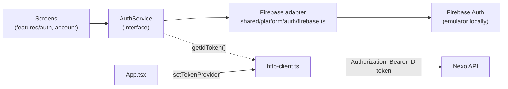
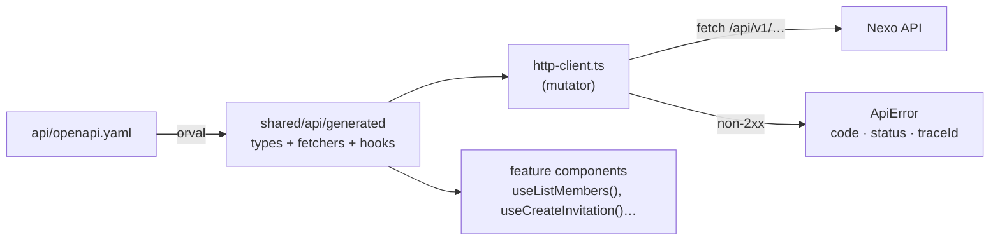

# Frontend architecture

**English** · [Español](README.es.md)

How the Nexo web app is built: technologies, structure, how data flows from the API to the screen, how authentication works and the rules that keep it consistent. The *why* behind each choice is in the [Architecture Decision Records](adr/README.md).

> **Status:** the app covers everything of the first milestone: sign in and sign up (email/password and Google), creating and switching workspaces, the members of a workspace with roles, and invitations (by email and by link). Projects and tasks arrive in milestone M1. Items marked *planned* are decided but not built yet.

**Related:** [Backend architecture](../backend/README.md) · [Authentication and users (backend)](../backend/auth.md) · [CI](../ci.md)

---

## 1. Overview

A **single-page application in React**, built with **Vite** and served as static files. It talks only to the Nexo API through a **client generated from the OpenAPI contract**, keeps server data in **TanStack Query**, routes with **TanStack Router**, signs people in with **Firebase Authentication** behind an adapter and is **bilingual** (Spanish and English) from the start.

Guiding principles (from the product vision):

| Principle | What it means for the frontend |
|---|---|
| **Speed is a feature** | Cached server state, route-level code splitting; optimistic updates *(planned)* |
| **Keyboard first, mouse too** | Everything works with the keyboard; shortcuts and a command palette (`Ctrl+K`) *(planned)* |
| **Everything is linkable** | Views live in the URL, with typed params and search params |
| **Simple by default** | Configuration never sits in the way of the main flow |
| **Everyone's language** | "Tasks" and "projects", not jargon; Spanish and English, switchable at any time |
| **Accessible** | Labelled fields, announced errors, visible focus, skip link, keyboard navigation |

## 2. Technology stack

| Concern | Technology | Status |
|---|---|---|
| UI library | React 19 | ✅ |
| Build tool / dev server | Vite 8 | ✅ |
| Language | TypeScript 6, strict | ✅ |
| Routing | TanStack Router (file-based) | ✅ |
| Server state | TanStack Query 5 | ✅ |
| UI state | Zustand 5 | ✅ (installed, used when needed) |
| API client | orval (generated from `api/openapi.yaml`) | ✅ |
| Authentication | Firebase Auth JS SDK (modular), behind an adapter | ✅ |
| Forms and validation | react-hook-form + Zod | ✅ |
| Styling | Tailwind CSS 4 + small hand-written components in `shared/ui` | ✅ |
| Accessible overlays (dialogs, menus), drag and drop, command palette | Radix primitives, dnd-kit, cmdk | *planned* (when a screen needs them) |
| i18n | i18next + react-i18next | ✅ |
| Unit/component tests | Vitest + Testing Library (jsdom) | ✅ |
| End-to-end / a11y | Playwright + axe | *planned* |
| Lint / format | ESLint 10 (typescript-eslint), Prettier (+ Tailwind plugin) | ✅ |
| Runtime / package manager | Node 24 LTS (`.nvmrc`), pnpm (pinned in `package.json`) | ✅ |

## 3. Project layout

```
frontend/
├── index.html
├── vite.config.ts          Plugins (router, React, Tailwind), `@` alias, dev proxy, Vitest
├── orval.config.ts         API client generation (+ Prettier on the output)
├── tsr.config.json         Route tree generation (same settings as the Vite plugin)
├── eslint.config.js        Lint rules, including import boundaries
└── src/
    ├── main.tsx            The one place where the identity provider is created
    ├── app/
    │   ├── App.tsx         Providers, token provider for the API client, cache reset on user change
    │   ├── AppShell.tsx    Header, workspace navigation and content frame of signed-in pages
    │   ├── CenteredLayout.tsx   Simple frame for sign-in and invitation pages
    │   ├── guards.ts       Route guards (requireAuth, redirectIfSignedIn)
    │   ├── safe-redirect.ts     Validates the post-login redirect (no open redirects)
    │   ├── router.ts       Router instance and context (QueryClient, auth)
    │   ├── query-client.ts TanStack Query defaults
    │   ├── routes/         File-based routes: thin, they render a feature
    │   └── routeTree.gen.ts     Generated: do not edit
    ├── features/           One folder per feature; public API through index.ts
    │   ├── account/        Verification banner, language switcher, user menu
    │   ├── auth/           Sign in / sign up / password reset page
    │   ├── invitations/    Invite form, pending invitations, accept page
    │   ├── system/         API connection indicator
    │   └── workspaces/     Create, switch, home, members
    ├── shared/
    │   ├── api/            Generated client, HTTP mutator (token, ApiError), error messages
    │   ├── platform/       Adapters to third-party services
    │   │   ├── auth/       AuthService interface + Firebase implementation + React bindings
    │   │   └── i18n/       i18next setup and locales (es, en)
    │   ├── ui/             Button, Input, Select, Field, Alert, Card, Spinner
    │   ├── forms.ts · format.ts · roles.ts · storage.ts   Small shared helpers
    └── test/               Fake auth, fake API, fixtures, renderApp
```

**Where does new code go?**

| It is… | Put it in |
|---|---|
| A screen or behaviour of one product area (board, tasks, invitations) | `features/<feature>/` |
| A URL | `app/routes/` — thin: it renders a feature component |
| A reusable visual component with no business knowledge | `shared/ui/` |
| Access to a third-party SDK (Firebase, analytics…) | `shared/platform/<service>/` |
| An API call | Nowhere by hand: use the generated hooks from `shared/api/generated` |

Features never import each other's internals, only their `index.ts`; and two features must not depend on each other in a circle (shared things go to `shared/`).

## 4. Bootstrap and providers

`main.tsx` creates the **auth service** (`createFirebaseAuth(readFirebaseConfig())`) and renders `<App auth={auth} />`. `App`:

- creates **one `QueryClient`** and **one router** (the router context carries both the `QueryClient` and the auth service);
- registers the **token provider** of the API client, so every request carries the ID token;
- **clears the query cache whenever the signed-in account changes** (sign in, sign out, switching accounts), so one person never sees another's cached data;
- wraps everything in `AuthProvider` and `QueryClientProvider`.

Query defaults: `staleTime` 30 s; **4xx errors are not retried**; network and 5xx errors are retried up to twice. Devtools are rendered only in development.

## 5. Routing and guards

| Route | Page | Access |
|---|---|---|
| `/login?redirect=…` | Sign in, create an account, recover the password | Public; signed-in people are sent on to `redirect` |
| `/invitations/$token` | Preview and accept an invitation | Needs sign-in |
| `/` | Goes to the last workspace used, the first one, or to creating the first | Needs sign-in |
| `/workspaces/new` | Create a workspace | Needs sign-in |
| `/workspaces/$workspaceId` | Workspace home | Member |
| `/workspaces/$workspaceId/members` | Members, roles and invitations | Member (managing: admins) |

- Routes are **files** in `src/app/routes`; `_app.tsx` is a *pathless layout* that wraps every page of signed-in people with the `AppShell` and the guard. The router plugin generates `routeTree.gen.ts`; each route is **code-split** automatically.
- **Guards** (`guards.ts`) run in `beforeLoad`: they wait for the initial authentication state, then redirect signed-out visitors to `/login?redirect=<where they were going>`.
- **`safeRedirect`** accepts only paths of this app for the `redirect` parameter: `https://evil.example`, `//evil.example`, backslashes and control characters are ignored. Without it, a crafted login link could send people to a malicious site right after they authenticate.
- Workspace pages are wrapped by `WorkspaceLayout`, which loads the workspace once, explains the error if the person cannot open it (the API answers 404 to non-members) and remembers it as the last one used.

## 6. Authentication



- **`AuthService`** (`shared/platform/auth/types.ts`) is everything the app needs from an identity provider: state (`getSnapshot`/`subscribe`, used through `useAuth()` with `useSyncExternalStore`), `ready()`, `getIdToken()`, and the actions (sign in/up with password, Google, sign out, password reset, verification email, `refreshUser`). Only `firebase.ts` imports the SDK (ESLint enforces it).
- **Sign up** creates the account, sets the name, gets a **fresh token that already carries the name** and sends the **verification email**. The API creates the user's profile on the first authenticated request, so nothing else has to be called.
- **Errors** are translated from the SDK codes to our own (`INVALID_CREDENTIALS`, `EMAIL_IN_USE`, …); the UI shows `auth.errors.<CODE>`. Closing the Google popup is not an error.
- **Email verification:** people who signed up with a password see a banner until they verify. It matters because **accepting an email invitation requires a verified email**. "I have verified it" reloads the account *and refreshes the token*, because the API reads `email_verified` from the token.
- **Token to the API:** the HTTP client asks the token provider for the ID token on every request. If the API answers `INVALID_TOKEN` (an expired token), it asks for a **fresh token and retries once**.
- **Signing out** goes back to `/login` and clears the cache.

## 7. Talking to the API



- **Never write fetch calls or API types by hand.** `pnpm generate` (or `make generate`) regenerates the client from the contract and formats it; CI fails if it is stale.
- Each operation produces a fetcher and a TanStack Query hook. After a mutation, features invalidate the affected queries with the generated `get…QueryKey()` helpers.
- All requests go through **one mutator** ([`http-client.ts`](../../frontend/src/shared/api/http-client.ts)): it adds the bearer token and returns the parsed body, or throws **`ApiError`** with the backend `code`, `status`, `traceId` and the full `problem` (`UNEXPECTED_RESPONSE` for other error bodies, `NETWORK_ERROR` with status 0 when the request cannot be sent; aborted requests are re-thrown untouched).
- In development, Vite proxies `/api` to `http://localhost:8080`: same origin, no CORS.

## 8. Errors and translations

- Messages live in `shared/platform/i18n/locales/{es,en}.json`. The language is the one the person chose (remembered in `localStorage`, and the page's `lang` attribute follows it) or, the first time, the browser's (Spanish if it starts with `es`).
- **Backend errors are translated by their code**: `useErrorMessage()` turns an `ApiError` into `t('errors.<CODE>')`, with a generic fallback. Every new backend code needs an entry in both locale files.
- Error UIs can show the **trace code** (`traceId`) so users can report it and developers can find the exact log line.

## 9. Forms

- **react-hook-form + Zod** (`zodResolver`). Schemas use **translation keys as error messages** (`'validation.required'`), and `useFieldError()` translates them when shown, so messages follow the current language.
- `Field` (in `shared/ui`) renders the label, the control, a hint and the error, wired with `id`, `aria-invalid` and `aria-describedby`; errors are announced with `role="alert"`.
- Server errors (a `Problem`) are shown in an `Alert` above the form.
- Validation in the form is a convenience: the API validates again and has the last word.

## 10. State management

| State | Where | Example |
|---|---|---|
| Server data | TanStack Query (generated hooks) | workspaces, members, invitations, the current user |
| Authentication | `AuthService` (via `useAuth()`) | who is signed in, email verified |
| URL state | TanStack Router params and search params | current workspace, `redirect` |
| Shared UI state | Zustand store *(planned)* | command palette open, sidebar collapsed |
| Local UI state | `useState` in the component | a confirmation being shown |
| Per-person conveniences | `localStorage` through `safeStorage` | language, last workspace |

Server data is **never copied** into Zustand or component state: read it from the query cache. `safeStorage` never throws (it can be unavailable or full), and nothing that must persist lives there.

## 11. Styling and UI components

- **Tailwind CSS 4** through its Vite plugin; Prettier sorts classes; `cn()` (clsx + tailwind-merge) joins them.
- **`shared/ui`** has small hand-written components in the shadcn style: `Button` (variants, `loading`), `Input`, `Select` (native), `Field`, `Alert`, `Card`, `Spinner`. Radix primitives, dnd-kit and cmdk will be added when a screen needs a dialog, a menu, drag and drop or the command palette ([ADR-0012](adr/0012-ui-primitives-and-forms.md)).
- **Accessibility is a requirement:** every control has a label, errors are announced, focus is visible, there is a *skip to content* link, native controls are preferred, destructive actions ask for confirmation, and the layout works from 375 px wide (tables scroll inside their card).

## 12. Platform adapters and import rules

Third-party services are wrapped in `shared/platform`, mirroring the backend adapters ([ADR-0006](adr/0006-feature-structure-and-adapters.md)):

| Adapter | Status |
|---|---|
| `i18n` (i18next) | ✅ |
| `auth` (Firebase Auth) | ✅ ([ADR-0011](adr/0011-frontend-authentication.md)) |
| `realtime` (Firestore signal listener → query invalidation) | *planned* |

ESLint enforces the boundaries:

- importing `firebase` outside `src/shared/platform/**` is an **error**;
- importing a feature's internals (`@/features/x/y`) instead of its public `index.ts` is an **error**;
- generated files are excluded from lint; the API client is formatted with Prettier right after generation (orval hook), so contract changes produce clean diffs.

## 13. Configuration

Public build-time settings, as `VITE_*` variables ([`frontend/.env.example`](../../frontend/.env.example)):

| Variable | Description |
|---|---|
| `VITE_FIREBASE_API_KEY` | Firebase web API key (not a secret). Required in production builds |
| `VITE_FIREBASE_PROJECT_ID` | Firebase project. Required in production builds |
| `VITE_FIREBASE_AUTH_DOMAIN` | Optional; needed for the Google popup in production |
| `VITE_FIREBASE_AUTH_EMULATOR_URL` | Auth emulator. In development it defaults to `http://localhost:9099`; **a production build refuses to start with it** (the emulator accepts unsigned tokens) |

In development nothing needs configuring: everything defaults to the local emulator (`make up`). Secrets never live in the frontend.

`vite.config.ts`: dev server on port 5173, `/api` proxy to `localhost:8080`, `@` → `src`.

## 14. Testing

| Level | Tool | What |
|---|---|---|
| Units and components | Vitest + Testing Library + jsdom | The HTTP client (token, retry), config, error mapping, `safeRedirect` |
| Screens and flows | The same, with the **real router and guards** | Sign in/up, workspace creation, members, invitations, verification banner, language |
| End-to-end and accessibility | Playwright + axe against Docker Compose with seed data | *planned* |

Helpers in `src/test`: **`createFakeAuth()`** (an `AuthService` that records every action), **`mockApi()`** (replaces `fetch` with a fake API keyed `"METHOD /path"`, and records unexpected requests), **fixtures** and **`renderApp({ path, auth })`**, which mounts the whole app on a memory history. Tests are written from the user's point of view (labels, roles, texts), not implementation details, and they run in Spanish.

## 15. Quality gates

| Command | What |
|---|---|
| `pnpm lint` | ESLint, including import boundaries and React Compiler checks |
| `pnpm format:check` | Prettier (generated client included) |
| `pnpm typecheck` | `tsc -b` (tests included) |
| `pnpm test` | Vitest |
| `pnpm build` | Production bundle |
| `pnpm generate` | API client + route tree (CI checks they are up to date) |

All of them run in CI on pull requests that touch `frontend/` or `api/`. Git hooks (lefthook) run ESLint and Prettier on staged files.

## 16. Local development

```bash
nvm use            # Node 24 from .nvmrc
make up            # PostgreSQL, Firebase Auth emulator, Mailpit
make dev-api       # API on :8080
make dev-web       # web on http://localhost:5173
```

Everything can be tried without any cloud account:

- **Sign up** in the app; the account is created in the Auth emulator (users and verification links: <http://localhost:4000>).
- **Invitation emails** arrive in Mailpit: <http://localhost:8025>.
- To verify an email in local, open its verification link from the emulator UI (Authentication → the account), then press "I have verified it" in the app.

## 17. Next steps

| Item | When |
|---|---|
| Seed data (`make db-seed`) and the CLA | Milestone M0, next PR |
| Playwright + axe in CI with the first full flow | Milestone M0, next PR |
| Projects, tasks, board and list views (+ dnd-kit, cmdk, Radix overlays as needed) | Milestone M1 |
| Optimistic updates, command palette, shortcuts | With the board |
| Real-time invalidation via Firestore signals | When the backend publishes signals |
